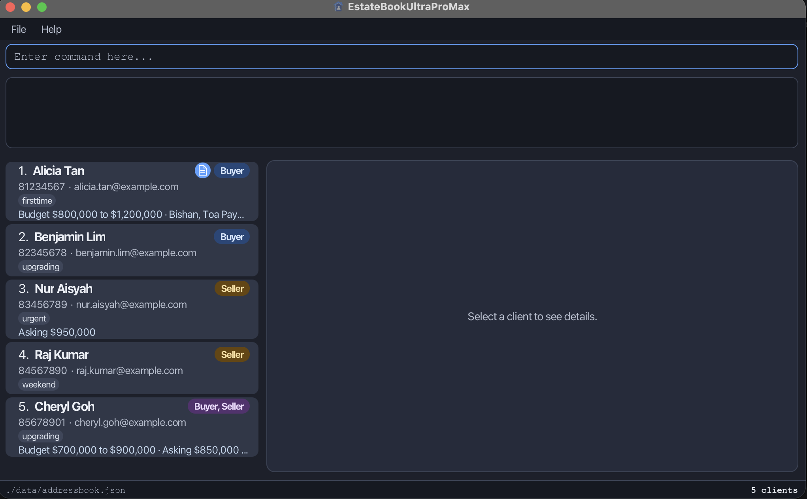

# EstateBookUltraProMax

EstateBookUltraProMax is a desktop contact book for property agents who manage
many buyers and sellers at once. Every action is a short command typed into the
command box, and the result appears in the GUI.

Each client record stores a name, a phone number, email address, address and tags.
Clients can also be marked as a buyer, a seller, or both.

Records are stored in one file that can be opened and edited by hand. There is no
server and no database.

* Mark a client as a buyer, a seller, or both.
* Find clients by any part of their name, phone number, or email address.
* List all clients.
* If you can type fast, EstateBookUltraProMax can get your client management
  tasks done faster than a mouse-driven app.

Useful links:
* [Product Website](https://ay2627s1-cs2103t-w09-3.github.io/tp/)
* [User Guide](https://ay2627s1-cs2103t-w09-3.github.io/tp/UserGuide.html)
* [Developer Guide](https://ay2627s1-cs2103t-w09-3.github.io/tp/DeveloperGuide.html)

Acknowledgements:
* This project is based on the AddressBook-Level3 project created by the
  [SE-EDU initiative](https://se-education.org).
