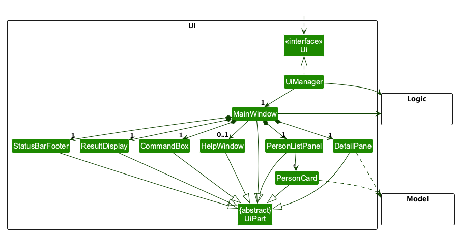
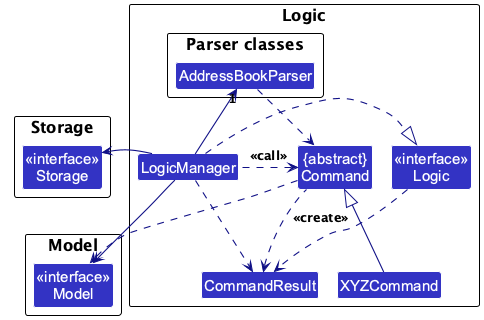
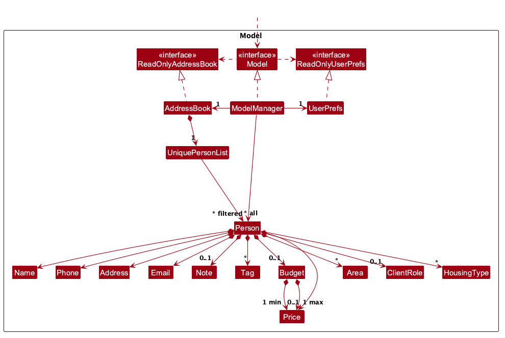
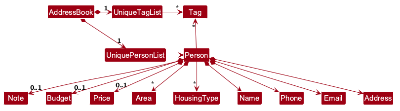
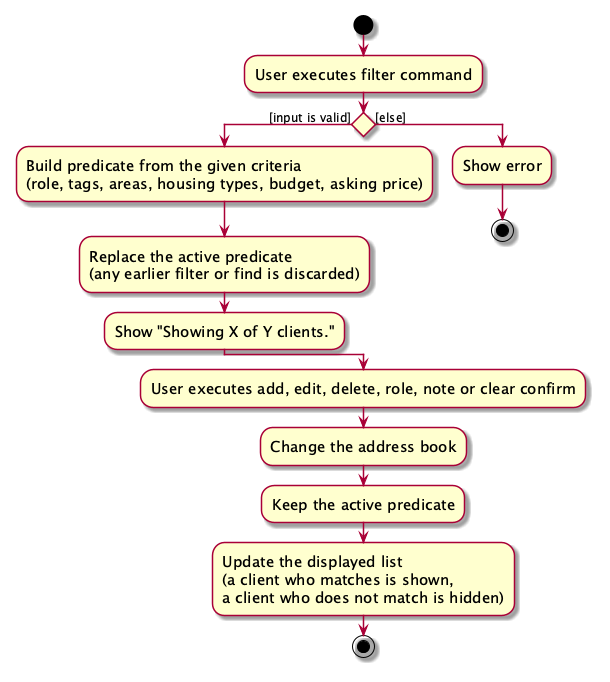

* Table of Contents
{:toc}

--------------------------------------------------------------------------------------------------------------------

## **Acknowledgements**

* Libraries used: [JavaFX](https://openjfx.io/), [Jackson](https://github.com/FasterXML/jackson), [JUnit5](https://github.com/junit-team/junit5)
* This project is based on the AddressBook-Level3 project created by the [SE-EDU initiative](https://se-education.org).

--------------------------------------------------------------------------------------------------------------------

## **Setting up, getting started**

Refer to the guide [_Setting up and getting started_](SettingUp.md). When launching the app from IntelliJ IDEA, add `-ea` to the run configuration's **VM options** so assertions are enabled; the Gradle `run` task enables them automatically.

--------------------------------------------------------------------------------------------------------------------

## **Design**

:bulb: **Tip:** The `.puml` files used to create diagrams are in `docs/diagrams`. Refer to the [_PlantUML Tutorial_ at se-edu/guides](https://se-education.org/guides/tutorials/plantUml.html) to learn how to create and edit diagrams.

### Architecture

The ***Architecture Diagram*** given above explains the high-level design of the App.

The following provides a quick overview of the main components and their interactions.

**Main components of the architecture**

**`Main`** (consisting of classes [`Main`](https://github.com/AY2627S1-CS2103T-W09-3/tp/tree/master/src/main/java/seedu/address/Main.java) and [`MainApp`](https://github.com/AY2627S1-CS2103T-W09-3/tp/tree/master/src/main/java/seedu/address/MainApp.java)) is in charge of the app launch and shut down.
* At app launch, it initializes the other components in the correct sequence, and connects them up with each other.
* At shut down, it shuts down the other components and invokes cleanup methods where necessary.

The bulk of the app's work is done by the following four components:

* [**`UI`**](#ui-component): The UI of the App.
* [**`Logic`**](#logic-component): The command executor.
* [**`Model`**](#model-component): Holds the data of the App in memory.
* [**`Storage`**](#storage-component): Reads data from, and writes data to, the hard disk.

[**`Commons`**](#common-classes) represents a collection of classes used by multiple other components.

**How the architecture components interact with each other**

The *Sequence Diagram* below shows how the components interact with each other for the scenario where the user issues the command `delete 1`.

Each of the four main components (also shown in the diagram above),

* defines its *API* in an `interface` with the same name as the Component.
* provides its functionality through a concrete `{Component Name}Manager` class that implements the corresponding API interface.

For example, the `Logic` component defines its API in `Logic.java` and implements it in `LogicManager.java`. Other components interact with a component through its interface rather than its concrete class, preventing them from coupling to that component's implementation, as illustrated in the following partial class diagram.

The sections below give more details of each component.

### UI component

The **API** of this component is specified in [`Ui.java`](https://github.com/AY2627S1-CS2103T-W09-3/tp/tree/master/src/main/java/seedu/address/ui/Ui.java)

The UI consists of a `MainWindow` and its parts, such as `CommandBox`, `ResultDisplay`, `PersonListPanel`, and `StatusBarFooter`. All of these, including `MainWindow`, inherit from the abstract `UiPart` class, which captures common behavior among classes that represent visible GUI parts.

The `UI` component uses the JavaFX UI framework. The layouts of these UI parts are defined in matching `.fxml` files in `src/main/resources/view`. For example, [`MainWindow.fxml`](https://github.com/AY2627S1-CS2103T-W09-3/tp/tree/master/src/main/resources/view/MainWindow.fxml) specifies the layout of [`MainWindow`](https://github.com/AY2627S1-CS2103T-W09-3/tp/tree/master/src/main/java/seedu/address/ui/MainWindow.java).

The `UI` component,

* executes user commands using the `Logic` component.
* listens for changes to `Model` data so that the UI can be updated with the modified data.
* keeps a reference to the `Logic` component, because the `UI` relies on the `Logic` to execute commands.
* depends on some classes in the `Model` component because it displays `Person` objects from the model.

### Logic component

**API** : [`Logic.java`](https://github.com/AY2627S1-CS2103T-W09-3/tp/tree/master/src/main/java/seedu/address/logic/Logic.java)

Here's a (partial) class diagram of the `Logic` component:

The sequence diagram below illustrates the interactions within the `Logic` component, taking `execute("delete 1")` API call as an example.

:information_source: **Note:** The lifeline for `DeleteCommandParser` should end at the destroy marker (X), but due to a limitation of PlantUML, it continues to the end of the diagram.

How the `Logic` component works:

1. When `Logic` is called upon to execute a command, the command is passed to an `AddressBookParser` object, which in turn creates a parser that matches the command (e.g., `DeleteCommandParser`) and uses it to parse the command.
1. This results in a `Command` object (more precisely, an object of one of its subclasses e.g., `DeleteCommand`) which is executed by the `LogicManager`.
1. The command can communicate with the `Model` when it is executed (e.g. to delete a person). 
   Note that although this is shown as a single step in the diagram above for simplicity, the code can require several interactions between the command object and the `Model` to complete the operation.
1. The result of the command execution is encapsulated as a `CommandResult` object which is returned from `Logic`.

Here are the other classes in `Logic` (omitted from the class diagram above) that are used for parsing a user command:

How the parsing works:
* When called upon to parse a user command, the `AddressBookParser` class creates an `XYZCommandParser` (`XYZ` is a placeholder for the specific command name, e.g., `AddCommandParser`). The parser uses the other classes shown above to parse the user command and create an `XYZCommand` object (e.g., `AddCommand`). The `AddressBookParser` returns that object as a `Command` object.
* All `XYZCommandParser` classes, such as `AddCommandParser` and `DeleteCommandParser`, implement the `Parser` interface so they can be treated similarly where appropriate, for example during testing.

### Model component
**API** : [`Model.java`](https://github.com/AY2627S1-CS2103T-W09-3/tp/tree/master/src/main/java/seedu/address/model/Model.java)

The `Model` component,

* stores the address book data i.e., all `Person` objects (which are contained in a `UniquePersonList` object).
* stores the `Person` objects selected by the current filter, such as search results, in a separate _filtered_ list. It exposes this list as an unmodifiable `ObservableList<Person>` that the UI can observe and bind to, so the UI updates when the list changes.
* stores a `UserPrefs` object that represents the user’s preferences (currently, just the GUI settings). This is exposed to the outside as a `ReadOnlyUserPrefs` object.
* does not depend on any of the other three components (as the `Model` represents data entities of the domain, they should make sense on their own without depending on other components)

:information_source: **Note:** The alternative, arguably more object-oriented, design below keeps a unique list of tags in `AddressBook`, and each `Person` references tags from that list. This lets `AddressBook` maintain one `Tag` object per unique tag instead of each `Person` holding its own `Tag` objects. 

### Storage component

**API** : [`Storage.java`](https://github.com/AY2627S1-CS2103T-W09-3/tp/tree/master/src/main/java/seedu/address/storage/Storage.java)

The `Storage` component,
* can save both address book data and user preference data in JSON format, and read them back into corresponding objects.
* is implemented by `StorageManager`, which delegates the actual JSON file access to `JsonAddressBookStorage` and `JsonUserPrefsStorage` (one class per data file).
* depends on some classes in the `Model` component (because the `Storage` component's job is to save/retrieve objects that belong to the `Model`)

### Common classes

Classes used by multiple components are in the `seedu.address.commons` package.

--------------------------------------------------------------------------------------------------------------------

## **Implementation**

This section describes some noteworthy details on how certain features are implemented.

### Client role command

The `role` command assigns a transaction role to an existing client. It uses the
client's one-based index in the currently displayed client list.

**Format:** `role INDEX ROLE`

* `INDEX` must be a positive integer that refers to a client in the currently
  displayed list.
* `ROLE` must be `buyer`, `seller`, or `both`. Role values are
  case-insensitive.
* After a successful update, the client's badge shows `Buyer`, `Seller`, or `Buyer, Seller` respectively.
  The displayed list is not reset, so a search or filter that is active stays active.

The success message follows this format:

`Role updated: CLIENT_NAME is now marked as DISPLAY_ROLE`

The examples below are independent and assume that `Alicia Tan` is client 1 in
the currently displayed list.

| Command | Expected result |
|---------|-----------------|
| `role 1 buyer` | Alicia Tan's role becomes `Buyer`. The result box shows `Role updated: Alicia Tan is now marked as Buyer`. |
| `role 1 seller` | Alicia Tan's role becomes `Seller`. The result box shows `Role updated: Alicia Tan is now marked as Seller`. |
| `role 1 both` | Alicia Tan's role becomes `Buyer, Seller`. The result box shows `Role updated: Alicia Tan is now marked as Buyer, Seller`. |

Invalid inputs do not change the client's role:

| Situation | Expected result |
|-----------|-----------------|
| The command format or index syntax is invalid | `Error: Invalid command format. Use: role INDEX ROLE.` |
| The role is missing or is not `buyer`, `seller`, or `both` | `Error: Invalid Role: Role must be 'buyer', 'seller', or 'both'.` |
| The positive index is outside the currently displayed list | `Error: The client index provided is invalid.` |

The following sequence diagram shows how the `role 1 buyer` command is processed successfully:

### Client role storage

A client's role is a dedicated `ClientRole` field on `Person`, not a tag. `ClientRole` is an enum with exactly three declared values, and each value carries two strings: the token the user types and the data file stores, and the text the interface shows.

| Stored token | Shown to the user |
|--------------|-------------------|
| `buyer` | `Buyer` |
| `seller` | `Seller` |
| `both` | `Buyer, Seller` |

`ClientRole#getValue()` returns the stored token, `ClientRole#getDisplayValue()` returns the text shown, and `ClientRole#toString()` returns the display value, so a role cannot be shown one way in the result message and another way on the client's badge.

**Saving and reading back.** `JsonAdaptedPerson` mirrors the model field as a string. When a client book is saved the role is written with `ClientRole#getValue()`, and because the field carries `@JsonInclude(JsonInclude.Include.NON_NULL)`, a client with no role leaves the `role` key out of the data file entirely. When a client book is read back, a missing key becomes no role and any other value goes through `ClientRole#fromString(String)`; an unrecognised token raises an `IllegalValueException` carrying `Invalid Role: Role must be 'buyer', 'seller', or 'both'.`. A typo in a hand-edited data file is therefore reported rather than silently ignored.

**Why a dedicated field and not a tag.** Tags are free-form, they may be many, and they cannot be checked against a fixed set of values. A role is exactly one of three known values, it is validated as soon as the user supplies it, and it may also be absent, which a set of tags cannot express. `Person` compares roles with `Objects.equals`, so an unassigned role is a legal value rather than a missing one.

**Client books with no role.** A client book written before the role existed has no `role` key, and every record in it loads with no role assigned. The sample clients shipped with the app set roles so that the feature is visible on first run, and the model class diagram above shows `ClientRole` as an optional association of `Person`. The saving and reading path, `JsonAddressBookStorage` to `JsonSerializableAddressBook` to `JsonAdaptedPerson`, is unchanged and is shown in `StorageClassDiagram.puml`.

### Clear confirmation

`clear` deletes every client, so it needs two steps. `clear` warns and starts a pending state, and `clear confirm` completes it. Any other input cancels it.

**Parsing.** `ClearCommandParser` accepts no argument or exactly `confirm`, and creates `ClearCommand(isConfirmed)` with the flag set only for `confirm`. Any other argument raises a `ParseException` with `Invalid command format. Use: clear.`.

**Executing.** `ClearCommand#execute(Model)` counts the clients in the whole address book, not the filtered list, because clear also deletes hidden clients. It then does one of three things:

| Situation | Result |
|-----------|--------|
| The address book is empty | `The client book is already empty.` and nothing is pending |
| Not confirmed | `This will delete the only client. Type clear confirm to proceed.` for one client, or `This will delete all N clients. Type clear confirm to proceed.`, with `CommandResult#isAwaitingConfirmation()` set |
| Confirmed | Replaces the address book with an empty one and shows `Client book has been cleared!` |

**Remembering the pending state.** `LogicManager` holds one `isClearPending` flag. It is set from `CommandResult#isAwaitingConfirmation()` only after the data has been saved, so a failed save never leaves a clear pending. While the flag is set, the next input is parsed:

* `clear confirm` runs the confirmed `ClearCommand`.
* Any other input, including input that cannot be parsed, clears the flag without being executed and shows `Clear cancelled.`.

A completely empty Enter never reaches `Logic`, because `CommandBox` ignores an empty command box, so a pending clear stays pending. Input that is only spaces is sent on, cannot be parsed, and so cancels like any other input.

When nothing is pending, `clear confirm` is rejected with `No clear is pending. Type clear first.`, so the confirmation cannot be skipped. The flag is not written to the data file, so restarting the app cancels it.

**Showing the pending state.** `CommandBox` and `MainWindow` read `CommandResult#isAwaitingConfirmation()` from each result. While it is true, the command box gets the `pending` style class and a prompt asking the user to confirm, and `ResultDisplay` shows the warning with the same style class. The next result removes both, so the indicator is always the same as the state held by `LogicManager`.

**Why the state lives in `LogicManager`.** A `Command` is created again for every input, so it cannot remember the previous one. `Model` holds saved client data, and a pending confirmation is not data. Keeping the flag in `LogicManager` makes it testable without the UI, and the UI only has to display it.

**Alternatives considered.**
* **A stateless `clear confirm`:** the warning would be a hint only, because a user could skip it by typing `clear confirm` straight away. It also gives the UI nothing to show.
* **A confirmation popup:** this needs a window in the UI layer and cannot be tested through `Logic` alone.

### Filter command

`filter` narrows the displayed clients by role and tag. It uses the same filtered list as `find` and `list`, so the three commands share one active predicate and the latest of them wins.

**Parsing.** `FilterCommandParser` tokenizes the arguments with `PREFIX_ROLE` and `PREFIX_TAG`. It rejects any text before the first prefix, rejects a second `r/`, and parses the role with `ClientRole.fromString` after trimming it. The tags go through `ParserUtil#parseTags`. Both parts are optional, and the parser creates `FilterCommand` with a `PersonMatchesFilterPredicate` holding an `Optional<ClientRole>` and a `Set<Tag>`.

**The predicate.** `PersonMatchesFilterPredicate#test` is true only when both parts match:

* **Role.** A missing role always matches. `buyer` matches `BUYER` and `BOTH`, `seller` matches `SELLER` and `BOTH`, and `both` matches only `BOTH`. A client with no role never matches a given role.
* **Tags.** No tags always match. Otherwise, one matching tag is enough, and tag names are compared ignoring case.

So the role and the tags combine with AND, and the tags among themselves with OR.

**Executing.** `FilterCommand#execute(Model)` calls `Model#updateFilteredPersonList(predicate)`. This overwrites the predicate on the single `FilteredList`, so a filter does not stack with an earlier filter or `find`, and `find` and `list` replace a filter in the same way. It then counts the displayed clients and the clients in the whole address book, and shows `Showing X of Y clients.`. Y is the whole book, not the filtered list.

**Mutation commands.** `add`, `edit`, `delete`, `role` and `note` change `AddressBook` and never call `updateFilteredPersonList`, so the predicate stays set. `ModelManager` wraps `AddressBook#getPersonList()` in the `FilteredList`, which re-tests an added or replaced client against the predicate by itself. A client who no longer matches leaves the list, and no command has to refresh the list. Only `add` can make a client appear, because `edit` and `role` work on a client that is already displayed and so already matches; `delete` removes the client, and `note` changes neither the role nor the tags. Only `list` and a new `find` or `filter` change the predicate.

The following activity diagram shows how the active filter is set, and what happens to it after a successful `add`, `edit`, `delete`, `role` or `note`. A command that fails, for example because of an invalid index or a duplicate client, changes nothing, so the filter and the displayed list stay as they were:

**Why the filter is not cleared by mutations.** An agent who filters 60 clients down to 8 and then updates one of them should stay in that view. Resetting to the full list after every command would lose it.

**Alternatives considered.**
* **A second predicate that is combined with `find`:** this makes the visible list depend on the order of earlier commands, and the user has no way to see which parts are active. One predicate that is replaced is easier to explain.
* **Clearing the filter after every mutation:** simple to implement, but it loses the view, as described above.

--------------------------------------------------------------------------------------------------------------------

## **Documentation, logging, testing, dev-ops**

* [Documentation guide](Documentation.md)
* [Testing guide](Testing.md)
* [Logging guide](Logging.md)
* [DevOps guide](DevOps.md)

--------------------------------------------------------------------------------------------------------------------

## **Appendix: Requirements**

### Product scope

**Target user profile**:

* is a property agent who manages multiple buyers and sellers simultaneously
* needs to retrieve client information quickly while handling calls, viewings, travel, and follow-ups
* needs to record clients' contact details, budgets, property preferences, viewing information, and follow-up status
* works primarily on a desktop or laptop
* prefers typing and keyboard-driven workflows over navigating with a mouse
* is comfortable using a Command Line Interface (CLI)
* may use their device where clients or colleagues can see the screen and therefore needs to protect sensitive client information

**Value proposition**: EstateBookUltraProMax gives property agents fast, CLI-optimised access to buyer and seller
contacts, budgets, property preferences, viewing information, and follow-up statuses. It removes the friction of
managing clients through spreadsheets by allowing records to be added, updated, and retrieved quickly using
keyboard-driven commands.

### User stories

Priorities: High (must have) - `* * *`, Medium (nice to have) - `* *`, Low (unlikely to have) - `*`

| Priority | As a …​ | I want to …​ | So that I can…​ |
| -------- | ------- | ------------ | --------------- |
| `* * *` | property agent | add a buyer contact with essential contact details | record a new buyer lead before I forget it |
| `* * *` | property agent | add a seller contact with essential contact details | record a new seller lead before I forget it |
| `* * *` | property agent | view all recorded contacts | see the clients currently under my care |
| `* * *` | property agent | view a selected client's full details | quickly understand the client's information and requirements |
| `* * *` | property agent | edit a client's contact details | keep the client's record accurate when their details change |
| `* * *` | property agent | delete a wrongly created contact | remove records that should not exist |
| `* * *` | property agent | find a client using one or more whole words from the client's name | locate the client's details without going through the entire list |
| `* * *` | property agent | find a client using their phone number or email address | identify an incoming caller or message quickly |
| `* * *` | property agent | record whether a client is a buyer, seller, or both | understand my relationship with the client at a glance |
| `* * *` | property agent | record a client's address | retain the client's important contact information |
| `* * *` | property agent | record a buyer's budget range | avoid proposing properties outside the buyer's means |
| `* * *` | property agent | record a buyer's preferred locations | shortlist properties in areas acceptable to the buyer |
| `* * *` | property agent | record a buyer's preferred property type | exclude unsuitable property categories |
| `* * *` | property agent | record a buyer's minimum bedroom requirement | avoid recommending properties that are too small |
| `* * *` | property agent | record notes about a client | retain important context that does not fit into the standard fields |
| `* * *` | property agent | tag contacts using meaningful labels | group clients according to attributes relevant to my work |
| `* * *` | property agent | record a viewing appointment for a client | remember the client's upcoming property viewing |
| `* * *` | property agent | view a client's viewing status | quickly determine whether a viewing has been scheduled |
| `* * *` | property agent | update a viewing's status | keep the client's viewing information current |
| `* * *` | property agent | exit the application safely | ensure that my latest changes are retained |
| `* *` | new property agent | view realistic sample clients | understand what information the application can manage |
| `* *` | new property agent | view concise help within the application | learn the available commands without leaving my workflow |
| `* *` | user ready to begin | clear all sample or experimental data | start with a clean client list |
| `* *` | property agent | filter contacts by buyer or seller role | focus on the relevant side of my client pipeline |
| `* *` | property agent | filter buyers by budget range | identify buyers who may be suitable for a property |
| `* *` | property agent | filter buyers by preferred location | identify buyers interested in a particular area |
| `* *` | property agent | view a client's upcoming viewings | prepare for the client's next appointment |
| `* *` | busy property agent | view all appointments for a selected day | plan my schedule and avoid missing appointments |
| `* *` | property agent | record feedback after a viewing | remember the client's response when choosing the next recommendation |
| `* *` | property agent | record a client's current follow-up status | know what action I need to take next |
| `* *` | property agent | record the next follow-up date | contact the client at an appropriate time |
| `* *` | property agent | view clients whose follow-ups are due or overdue | prioritise clients who require my attention |
| `* *` | property agent | sort contacts by name, latest update, or next follow-up | review my clients in an order suitable for my current task |
| `* *` | property agent | undo my most recent data-changing action | recover quickly from an input mistake |
| `* *` | property agent | detect possible duplicate contacts | avoid splitting one client's information across multiple records |
| `* *` | long-time property agent | archive an inactive client | reduce clutter without permanently losing past information |
| `* *` | returning property agent | restore an archived client | resume working with a past client who has become active again |
| `* *` | property agent migrating from spreadsheets | import client records from a common tabular format | avoid entering all my existing client information manually |
| `* *` | privacy-conscious property agent | mask sensitive client details on screen | work safely when other people can see my computer |
| `* *` | property agent | identify incomplete client records | fill important gaps before they affect my service |
| `*` | fast-typing property agent | use short aliases for common commands | reduce typing during repetitive work |
| `*` | property agent | reuse a recent command with small changes | process similar client updates efficiently |
| `*` | property agent | preview the records affected by a bulk command | avoid modifying the wrong clients |
| `*` | property agent | merge confirmed duplicate contacts | maintain one complete record for each client |
| `*` | property agent changing agencies | export selected client records | retain records that I am permitted to take with me |
| `*` | property agent | create a backup of my client records | reduce the risk of losing important information |
| `*` | property agent | restore my client records from a valid backup | recover my information after data loss or device replacement |
| `*` | property agent | view when and how a client record was last changed | determine whether the information is current |
| `*` | property agent | separate personal leads from agency-assigned leads | keep my different work contexts organised |
| `*` | property agent | record relationships between clients | recognise couples, co-buyers, family members, and co-owners |
| `*` | property agent | save a frequently used search | repeat a common client review without rebuilding the search criteria |

### Use cases

For all use cases below, the **System** is **EstateBookUltraProMax** and the **Actor** is a **property agent**, referred to as the **Agent**.

**MSS** stands for **Main Success Scenario**.

#### UC01: Register and classify a new client

**MSS**

1. Agent requests to add a client, providing the client's name, phone number, email address, address, and any optional tags.
2. EstateBookUltraProMax adds the client and displays the recorded details.
3. Agent requests to assign the new client a role of buyer, seller, or both.
4. EstateBookUltraProMax assigns the role and displays the client's updated role.

   Use case ends.

**Extensions**

* 1a. Required details are missing or one or more supplied values are invalid.
  * 1a1. EstateBookUltraProMax displays an error describing the invalid or missing details without adding the client.

  Use case resumes at step 1.

* 1b. The supplied name, phone number, or email address matches an existing client's.
  * 1b1. EstateBookUltraProMax identifies the conflicting field and rejects the addition.

  Use case resumes at step 1.

* 3a. The specified client reference is invalid.
  * 3a1. EstateBookUltraProMax displays an error without assigning a role.

  Use case resumes at step 3.

* 3b. The role is missing or is not buyer, seller, or both.
  * 3b1. EstateBookUltraProMax displays an error indicating the permitted roles.

  Use case resumes at step 3.

#### UC02: Update a client's contact details

**MSS**

1. Agent requests to find a client using one or more whole words from the client's name.
2. EstateBookUltraProMax displays a list of matching clients.
3. Agent identifies a client from the displayed results and requests changes to the client's contact details.
4. EstateBookUltraProMax updates the specified details and displays the updated client.

   Use case ends.

**Extensions**

* 1a. No search keyword is supplied.
  * 1a1. EstateBookUltraProMax displays an error indicating that a search keyword is required.

  Use case resumes at step 1.

* 2a. No clients match the search keywords.

  Use case ends.

* 3a. The specified client reference is invalid.
  * 3a1. EstateBookUltraProMax displays an error without updating the client.

  Use case resumes at step 3.

* 3b. No changes are supplied, or one or more supplied values are invalid.
  * 3b1. EstateBookUltraProMax displays an error without updating the client's details.

  Use case resumes at step 3.

* 3c. The updated name, phone number, or email address would match another client's details.
  * 3c1. EstateBookUltraProMax displays an error identifying the conflict and rejects the update.

  Use case resumes at step 3.

#### UC03: Change a client's role

**MSS**

1. Agent requests to list all clients.
2. EstateBookUltraProMax displays the clients and their assigned roles.
3. Agent identifies a client from the displayed list and requests to change the client's role to buyer, seller, or both.
4. EstateBookUltraProMax updates the client's role and displays the updated client.

   Use case ends.

**Extensions**

* 2a. The client list is empty.

  Use case ends.

* 3a. The specified client reference is invalid.
  * 3a1. EstateBookUltraProMax displays an error without updating the client's role.

  Use case resumes at step 3.

* 3b. The role is missing or is not buyer, seller, or both.
  * 3b1. EstateBookUltraProMax displays an error indicating the permitted roles without updating the client's role.

  Use case resumes at step 3.

#### UC04: Delete a client

**MSS**

1. Agent requests to list all clients.
2. EstateBookUltraProMax displays the client list.
3. Agent requests to delete a specific client from the displayed list.
4. EstateBookUltraProMax deletes the client, identifies the deleted client, and displays the updated list.

   Use case ends.

**Extensions**

* 2a. The client list is empty.

  Use case ends.

* 3a. The specified client reference is missing or invalid.
  * 3a1. EstateBookUltraProMax displays an error without deleting any client.

  Use case resumes at step 3.

#### UC05: Record a client's viewing outcome

**MSS**

1. Agent requests to view a client's viewing records.
2. EstateBookUltraProMax displays the client's viewing records and their statuses.
3. Agent identifies a viewing and provides the client's feedback and an updated viewing status.
4. EstateBookUltraProMax records the feedback and status and displays the updated viewing record.

   Use case ends.

**Extensions**

* 1a. The specified client does not exist.
  * 1a1. EstateBookUltraProMax displays an error without displaying any viewing records.

  Use case resumes at step 1.

* 2a. The client has no recorded viewings.

  Use case ends.

* 3a. The specified viewing does not exist among the client's viewing records.
  * 3a1. EstateBookUltraProMax displays an error without changing any viewing records.

  Use case resumes at step 3.

* 3b. The supplied viewing status is invalid.
  * 3b1. EstateBookUltraProMax displays an error indicating the permitted statuses without changing the viewing records.

  Use case resumes at step 3.

#### UC06: Update a client's follow-up plan

**MSS**

1. Agent requests to list clients whose follow-ups are due or overdue.
2. EstateBookUltraProMax displays the matching clients and their recorded follow-up details.
3. Agent identifies a client and provides an updated next action and follow-up date.
4. EstateBookUltraProMax records the updated follow-up plan and displays the updated details.

   Use case ends.

**Extensions**

* 2a. No clients have follow-ups that are due or overdue.

  Use case ends.

* 3a. The specified client reference is invalid.
  * 3a1. EstateBookUltraProMax displays an error without changing any follow-up plan.

  Use case resumes at step 3.

* 3b. The next action is missing or the follow-up date is invalid.
  * 3b1. EstateBookUltraProMax displays an error describing the missing or invalid details without changing the follow-up plan.

  Use case resumes at step 3.

### Non-Functional Requirements

1. **Usability:** A user with an above average typing speed for English text should be able to accomplish most tasks using the _Command Line Interface (CLI)_ and command _aliases_ than navigating with mouse-driven GUI.
2. **Environment:** The system should work on any _mainstream OS_ as long as it has Java `25` installed.
3. **Performance:** The system should be able to hold up to <ins>100</ins> active client records without any noticeable sluggishness in performance during typical usage (e.g., searching, filtering).
4. **Data Reliability:** The application must ensure that all data-changing actions are saved safely so that the latest changes are retained upon exiting.
5. **Fault Tolerance:** The application must gracefully handle invalid inputs (e.g., invalid client references, missing roles, or conflicting duplicate details) by displaying clear error messages, instead of crashing.

### Glossary

| Term                             | Definition                                                                                                                                                                         |
|:---------------------------------|:-----------------------------------------------------------------------------------------------------------------------------------------------------------------------------------|
| **CLI (Command Line Interface)** | A text-based user interface where the agent interacts with the application by typing commands, optimised for speed and keyboard-driven workflows.                                  |
| **Mainstream OS**                | Standard desktop and laptop operating systems, specifically Windows, Linux, Unix, or macOS.                                                                                        |
| **Client Role**                  | The classification of a client's relationship with the agent. A client can be classified as a `Buyer`, a `Seller`, or `Both`.                                                      |
| **Viewing**                      | A scheduled appointment for a client to visit a property. It contains a status (e.g., `pending`, `completed`).                                                                     |
| **Tag**                          | A custom, meaningful label assigned to a client to group them according to specific attributes relevant to the agent's work.                                                       |
| **Alias**                        | A shortened, memorable version of a standard CLI command used to reduce typing overhead for fast-typing agents.                                                                    |
| **Duplicate Contact**            | A client record that shares a name, phone number or email with another record, which the system detects to prevent fragmented information.                                         |
| **Household Record**             | One record kept for couples or co-buyers who share contact details, tagged `t/couple`, since clients cannot share a phone number or email.                                         |
| **Property Preferences**         | A collective term for a buyer's specific real estate requirements, including their budget range, preferred locations, property type, and minimum bedroom requirements.             |
| **Sample Data**                  | A set of realistic, pre-loaded dummy client records provided to help new agents explore and learn the application's features safely before clearing it to start their actual work. |

--------------------------------------------------------------------------------------------------------------------

## **Appendix: Instructions for manual testing**

Given below are instructions to test the app manually.

Unless stated otherwise, start each subsection in a separate test folder that initially contains only the JAR file.
This ensures that the five sample clients are loaded and that their indexes are predictable. Back up
`data/addressbook.json` before any test that edits or removes it.

:information_source: **Note:** These instructions only provide a starting point for testers to work on;
testers are expected to do more *exploratory* testing.

### Launch and shutdown

1. Initial launch

   1. Ensure that Java `25` or later is installed on the computer.

   1. Download the JAR file and copy it into an empty folder.

   1. Open a terminal, change to the folder containing the JAR file, and run
      `java -jar estatebookultrapromax.jar`. 
      Expected: The GUI opens with five sample clients. The window size may not be optimal.

1. Saving window preferences

   1. Resize the window to an optimal size. Move the window to a different location. Enter `exit` to close the app.

   1. From the same folder, relaunch the app by running `java -jar estatebookultrapromax.jar`. 
       Expected: The most recent window size and location are retained.

### Changing a client's role

1. Changing a role while all clients are displayed

   1. Prerequisites: Run `list`. Confirm that `Alicia Tan` is client 1.

   1. Test case: `role 1 seller` 
      Expected: Alicia's badge changes to `Seller`. The result box shows
      `Role updated: Alicia Tan is now marked as Seller`.

   1. Test case: `edit 1 p/99998888` 
      Expected: Alicia's phone number changes to `99998888`, and her `Seller` badge remains displayed.

   1. Test case: `role 1 BUYER` 
      Expected: Role input is case-insensitive. Alicia's badge changes to `Buyer`. The result box shows
      `Role updated: Alicia Tan is now marked as Buyer`.

   1. Test case: `role 1 both` 
      Expected: Alicia's badge changes to `Buyer, Seller`. The result box shows
      `Role updated: Alicia Tan is now marked as Buyer, Seller`.

### Rejecting invalid role commands

1. Rejecting invalid formats, roles, and indexes

   1. Prerequisites: Run `list` and note the current role of client 1.

   1. Test case: `role 0 buyer` 
      Expected: No role is changed. The result box shows `Error: Invalid command format. Use: role INDEX ROLE.`

   1. Test case: `role 1` 
      Expected: No role is changed. The result box shows
      `Error: Invalid Role: Role must be 'buyer', 'seller', or 'both'.`

   1. Test case: `role 1 landlord` 
      Expected: No role is changed. The result box shows
      `Error: Invalid Role: Role must be 'buyer', 'seller', or 'both'.`

   1. Test case: `role 999 buyer` 
      Expected: No role is changed. The result box shows `Error: The client index provided is invalid.`

   1. Test case: `role 1 buyer extra` 
      Expected: No role is changed. The result box shows `Error: Invalid command format. Use: role INDEX ROLE.`

### Rejecting duplicate clients

1. Rejecting duplicate details when adding or editing a client

   1. Prerequisites: Run `list`. Confirm that `Alicia Tan` is client 1 and `Benjamin Lim` is client 2.

   1. Test case: `add n/Alicia Tan p/81111111 e/alicia.test@example.com a/1 Test Road` 
      Expected: No client is added. The result box shows
      `Error: A client with this name already exists in the client book.`

   1. Test case: `add n/Test Buyer p/81234567 e/test.buyer@example.com a/2 Test Road` 
      Expected: No client is added. The result box shows
      `Error: This phone number already belongs to another client: Alicia Tan. For co-buyers, use one household record tagged t/couple.`

   1. Test case: `add n/Test Seller p/82222222 e/alicia.tan@example.com a/3 Test Road` 
      Expected: No client is added. The result box shows
      `Error: This email address already belongs to another client: Alicia Tan. For co-buyers, use one household record tagged t/couple.`

   1. Test case: `edit 2 p/81234567` 
      Expected: Benjamin's details are unchanged. The result box shows
      `Error: This phone number already belongs to another client: Alicia Tan. For co-buyers, use one household record tagged t/couple.`

### Using indexes from a filtered list

1. Changing the role of a client in filtered results

   1. Test case: `find Benjamin` 
      Expected: Only `Benjamin Lim` is displayed, at index 1. The result box shows `1 client listed!`.

   1. Test case: `role 1 seller` 
      Expected: Benjamin's badge changes to `Seller`, even though he is client 2 in the full list. The search stays active,
      so only Benjamin is still displayed. The result box shows `Role updated: Benjamin Lim is now marked as Seller`.

   1. Test case: `find Alicia`, followed by `role 2 buyer` 
      Expected: The filtered list contains only one client, so no role is changed. The result box shows
      `Error: The client index provided is invalid.`

### Saving and loading role data

1. Retaining a changed role after restarting the app

   1. Prerequisites: Run `list`, followed by `role 1 seller`.

   1. Exit the app using `exit`, then relaunch the same JAR file from the same folder. 
      Expected: Alicia's `Seller` badge is still displayed. `data/addressbook.json` contains
      `"role" : "seller"` in Alicia's client record.

2. Loading a client record that has no role field

   1. Prerequisites: Exit the app and back up `data/addressbook.json`.

   1. Remove the entire `"role" : "seller",` line from Alicia's client record, while keeping the remaining JSON valid.

   1. Relaunch the app. 
      Expected: All saved clients load normally. Alicia has no role badge, while her other details are unchanged.

   1. Exit the app and restore the backup.

### Handling missing or corrupted data

1. Starting with a missing data file

   1. Prerequisites: Run `list` to create the data file. Exit the app and rename `data/addressbook.json` to
      `addressbook.backup.json`.

   1. Relaunch the app. 
      Expected: The app starts normally with the five sample clients and creates a new valid
      `data/addressbook.json`.

   1. Run `list`. 
      Expected: The sample clients remain displayed. The result box shows `Listed all clients.`

2. Starting with corrupted data

   1. Prerequisites: Run `list`, followed by `role 1 seller`, to create data containing a role. Exit the app and back
      up `data/addressbook.json`.

   1. Either replace the file contents with text that is not valid JSON, or change a saved role value to an invalid
      value such as `"role" : "landlord"`.

   1. Relaunch the app. 
      Expected: The app does not crash and starts with an empty client list because the file cannot be loaded.

   1. Run `list`. 
      Expected: The result box shows `Listed all clients.` and the corrupted file is replaced with a valid empty
      client book. Restore the backup after completing the test.
