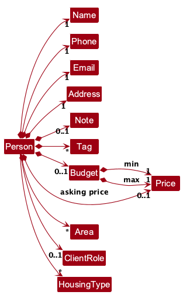
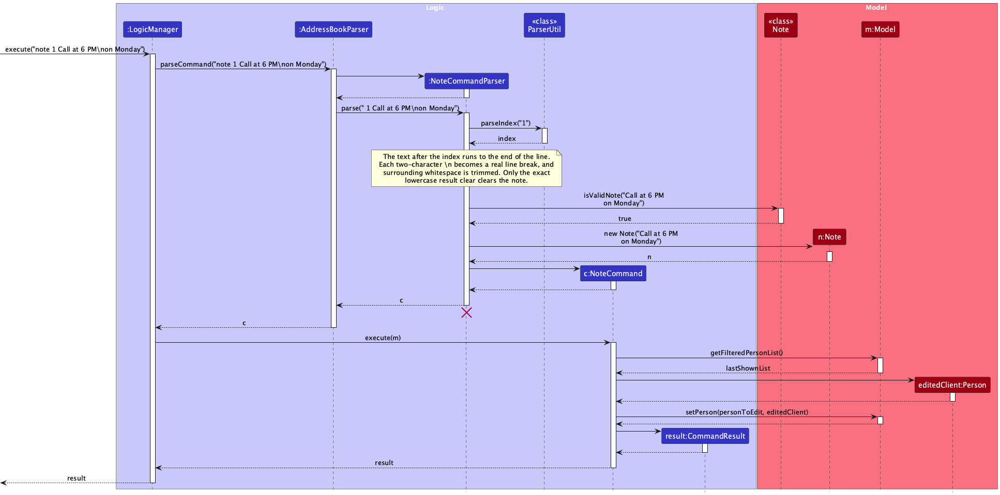
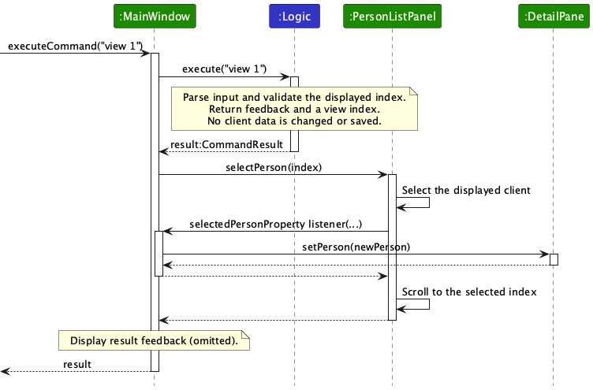

* Table of Contents
{:toc}

--------------------------------------------------------------------------------------------------------------------

## **Acknowledgements**

* Libraries used: [JavaFX](https://openjfx.io/), [Jackson](https://github.com/FasterXML/jackson), [JUnit5](https://github.com/junit-team/junit5)
* This project is based on the AddressBook-Level3 project created by the [SE-EDU initiative](https://se-education.org).

--------------------------------------------------------------------------------------------------------------------

## **Setting up, getting started**

Refer to the guide [_Setting up and getting started_](SettingUp.md). When launching the app from IntelliJ IDEA, add `-ea` to the run configuration's **VM options** so assertions are enabled; the Gradle `run` task enables them automatically.

--------------------------------------------------------------------------------------------------------------------

## **Design**

:bulb: **Tip:** The `.puml` files used to create diagrams are in `docs/diagrams`. Refer to the [_PlantUML Tutorial_ at se-edu/guides](https://se-education.org/guides/tutorials/plantUml.html) to learn how to create and edit diagrams.

### Architecture

The ***Architecture Diagram*** given above explains the high-level design of the App.
It is an architectural overview rather than a UML class model: solid arrows show
associations and dashed arrows show dependencies. The user and document icons
represent the agent and local files, not implementation classes.

The following provides a quick overview of the main components and their interactions.

**Main components of the architecture**

**`Main`** (consisting of classes [`Main`](https://github.com/AY2627S1-CS2103T-W09-3/tp/tree/master/src/main/java/seedu/address/Main.java) and [`MainApp`](https://github.com/AY2627S1-CS2103T-W09-3/tp/tree/master/src/main/java/seedu/address/MainApp.java)) is in charge of the app launch and shut down.
* At app launch, it initializes the other components in the correct sequence, and connects them up with each other.
* At shut down, it shuts down the other components and invokes cleanup methods where necessary.

The bulk of the app's work is done by the following four components:

* [**`UI`**](#ui-component): Accepts commands and displays client lists, profiles and feedback.
* [**`Logic`**](#logic-component): Interprets commands and coordinates data changes, saving and session history.
* [**`Model`**](#model-component): Holds client data, the active list view and undo/redo state in memory.
* [**`Storage`**](#storage-component): Loads and saves client data and preferences in local JSON files.

[**`Commons`**](#common-classes) provides shared utilities. Its individual dependencies
are omitted from the overview to avoid clutter; it is not a separate step in command execution.

**How the architecture components interact with each other**

The *Sequence Diagram* below shows how the components interact with each other for the scenario where the user issues the command `delete 1`.

### Component boundaries

The following partial class diagram is an implementation roadmap, not another
architecture-level view. It explains how component boundaries are represented in code.

Each of the four main components (also shown in the diagram above),

* defines its *API* in an `interface` with the same name as the Component.
* provides its functionality through a concrete `{Component Name}Manager` class that implements the corresponding API interface.

For example, the `Logic` component defines its API in `Logic.java` and implements it in `LogicManager.java`. Other components interact with a component through its interface rather than its concrete class, preventing them from coupling to that component's implementation, as illustrated in the following partial class diagram.

The sections below give more details of each component.

### UI component

The **API** of this component is specified in [`Ui.java`](https://github.com/AY2627S1-CS2103T-W09-3/tp/tree/master/src/main/java/seedu/address/ui/Ui.java)

The UI consists of a `MainWindow` and its parts, such as `CommandBox`, `ResultDisplay`, `PersonListPanel`, `DetailPane`, and `StatusBarFooter`. All of these, including `MainWindow`, inherit from the abstract `UiPart` class, which captures common behavior among classes that represent visible GUI parts.

`MainWindow` places `PersonListPanel` beside `DetailPane` in a master-detail
layout. The list panel shows the displayed clients as `PersonCard`s. Selecting
a client shows that client's profile in `DetailPane`; clearing the selection
shows its empty state. The `StatusBarFooter` below them shows the data file
path and a live client count. With no search or filter active, it shows the
total number of clients. While one is active, it shows the displayed and total
counts and reminds the user to run `list` to show all clients. The counts and
filter state are bound to the model, so the footer updates after data changes
as well as search and filter commands.

The menu bar provides `File` and `Help` actions, plus an `Edit` menu for `Undo`, `Redo` and `History`. The `Edit` actions submit the corresponding commands through `CommandBox`, so they use the same execution path and show feedback in `ResultDisplay` just like typed commands. Undo also has `Ctrl+Z` on Windows and Linux or `Cmd+Z` on macOS; redo has `Ctrl+Y` or `Cmd+Shift+Z`, respectively. These shortcuts work while the command box has focus. Menu actions and shortcuts do not submit unfinished command-box text, so a failed action leaves that text unchanged and does not give it the error style. The error style is applied only when a command submitted with Enter fails.

`Logic#canUndo()` and `Logic#canRedo()` expose the model's history availability to
`MainWindow`. The window disables unavailable Undo and Redo menu items on
startup and refreshes them after every command attempt, including a failed
save that rolls back a history transition. The History menu item remains
available even when both stacks are empty.

The scene-level history key filter runs before the command text field can handle
its own text undo. It consumes a recognized history shortcut even when the
corresponding menu item is disabled, so the app reports an unavailable action
instead of editing the user's draft. `MainWindowTest` covers this routing,
draft preservation, input styling and menu state.

The `UI` component uses the JavaFX UI framework. The layouts of these UI parts are defined in matching `.fxml` files in `src/main/resources/view`. For example, [`MainWindow.fxml`](https://github.com/AY2627S1-CS2103T-W09-3/tp/tree/master/src/main/resources/view/MainWindow.fxml) specifies the layout of [`MainWindow`](https://github.com/AY2627S1-CS2103T-W09-3/tp/tree/master/src/main/java/seedu/address/ui/MainWindow.java).

The `UI` component,

* executes user commands using the `Logic` component.
* listens for changes to `Model` data so that the UI can be updated with the modified data.
* keeps a reference to the `Logic` component, because the `UI` relies on the `Logic` to execute commands.
* depends on some classes in the `Model` component because it displays `Person` objects from the model.

### Logic component

**API** : [`Logic.java`](https://github.com/AY2627S1-CS2103T-W09-3/tp/tree/master/src/main/java/seedu/address/logic/Logic.java)

Here's a (partial) class diagram of the `Logic` component:

`LogicManager` holds one `AddressBookParser` instance, not a parser package.
Concrete command parsers are expanded in the parser diagram below; the package
boundary here only groups classes and is not an association endpoint.
`XYZCommand` represents concrete commands such as `AddCommand` and `FindCommand`.
Links to Model and Storage end at their API interfaces, not their packages.

The sequence diagram below illustrates the interactions within the `Logic` component, taking `execute("delete 1")` API call as an example.

:information_source: **Note:** The lifeline for `DeleteCommandParser` should end at the destroy marker (X), but due to a limitation of PlantUML, it continues to the end of the diagram.

How the `Logic` component works:

1. When `Logic` is called upon to execute a command, the command is passed to an `AddressBookParser` object, which in turn creates a parser that matches the command (e.g., `DeleteCommandParser`) and uses it to parse the command.
1. This results in a `Command` object (more precisely, an object of one of its subclasses e.g., `DeleteCommand`) which is executed by the `LogicManager`.
1. The command can communicate with the `Model` when it is executed (e.g. to delete a person). 
   Note that although this is shown as a single step in the diagram above for simplicity, the code can require several interactions between the command object and the `Model` to complete the operation.
1. The result of the command execution is encapsulated as a `CommandResult` object which is returned from `Logic`.

Here are the other classes in `Logic` (omitted from the class diagram above) that are used for parsing a user command:

How the parsing works:
* When called upon to parse a user command, the `AddressBookParser` class creates an `XYZCommandParser` (`XYZ` is a placeholder for the specific command name, e.g., `AddCommandParser`). The parser uses the other classes shown above to parse the user command and create an `XYZCommand` object (e.g., `AddCommand`). The `AddressBookParser` returns that object as a `Command` object.
* All `XYZCommandParser` classes, such as `AddCommandParser` and `DeleteCommandParser`, implement the `Parser` interface so they can be treated similarly where appropriate, for example during testing.

### Model component
**API** : [`Model.java`](https://github.com/AY2627S1-CS2103T-W09-3/tp/tree/master/src/main/java/seedu/address/model/Model.java)

The first class diagram focuses on model ownership and the filtered client list;
client value objects are shown separately below to keep both views readable.

The `Model` component,

* stores the address book data i.e., all `Person` objects (which are contained in a `UniquePersonList` object).
* stores each `Person` with an optional note, budget and asking price, and any number of areas and housing types.
* stores the `Person` objects selected by the current filter, such as search results, in a separate _filtered_ list. It exposes this list as an unmodifiable `ObservableList<Person>` that the UI can observe and bind to, so the UI updates when the list changes.
* stores a `UserPrefs` object that represents the user’s preferences (currently, just the GUI settings). This is exposed to the outside as a `ReadOnlyUserPrefs` object.
* does not depend on any of the other three components (as the `Model` represents data entities of the domain, they should make sense on their own without depending on other components)

The following class diagram expands `Person`. Multiplicities distinguish required,
optional and multi-valued fields; `Price` serves both asking prices and budget bounds.
Methods and history classes are omitted because this view concerns stored client fields.
These links are navigable associations, not compositions: immutable field values
can be reused when a client is replaced or captured in a history snapshot. A field
does not have an exclusive lifetime tied to one `Person` or `Budget`.

**Why duplicate emails ignore case.** `Person#isSamePerson` treats two clients as the same if their names match, or their phone numbers or email addresses are equal. It compares emails with `Email#isSameEmail`, which ignores case, because email providers treat `alpha.tester@EXAMPLE.COM` and `alpha.tester@example.com` as one mailbox, so an exact comparison would let the same address into two records. Strictly, only the domain is case-insensitive and the part before `@` may be case-sensitive, but no mainstream provider treats it that way, so the whole address is compared ignoring case. `Email#equals` stays exact, because it defines whether two clients hold identical data, which the undo history and the no-change check in `edit` rely on. The email is stored as it was typed.

:information_source: **Note:** The alternative, arguably more object-oriented, design below keeps a unique list of tags in `AddressBook`, and each `Person` references tags from that list. This lets `AddressBook` maintain one `Tag` object per unique tag instead of each `Person` holding its own `Tag` objects. 

Only the tag-related associations are shown; this is a proposed alternative, not the
current implementation.

**Why duplicate names ignore extra spaces.** `Person#isSamePerson` treats two clients as the same if their names match, or their phone numbers or email addresses are equal. `Name#isSameName` compares names ignoring case, leading and trailing spaces, and extra spaces between words, using `Name#collapseSpaces`. `Alpha  Tester` is therefore the same client as `Alpha Tester`, because an accidental extra space would otherwise create a second record for the same person. `ParserUtil#parseName` also collapses the spaces, so the name is stored as `Alpha Tester` and `find Alpha Tester` still finds it. The comparison still collapses spaces itself, so a name loaded from a data file that has extra spaces is compared in the same way.

### Storage component

**API** : [`Storage.java`](https://github.com/AY2627S1-CS2103T-W09-3/tp/tree/master/src/main/java/seedu/address/storage/Storage.java)

The `Storage` component,
* can save both address book data and user preference data in JSON format, and read them back into corresponding objects.
* is implemented by `StorageManager`, which delegates the actual JSON file access to `JsonAddressBookStorage` and `JsonUserPrefsStorage` (one class per data file).
* depends on some classes in the `Model` component (because the `Storage` component's job is to save/retrieve objects that belong to the `Model`)

`JsonUtil` reads JSON from a byte stream, allowing Jackson to detect a UTF-8 or
UTF-16 byte-order mark in a manually edited client book.

**Recovery belongs to startup.** The JSON reader reports invalid data;
`MainApp#initModelManager` decides whether it is safe to offer an empty book.
A missing file loads and saves sample clients. An unreadable file instead goes
through `backUpUnreadableDataFile`, which copies the original bytes beside it as
`addressbook.json.unreadable-<unique number>.bak` before creating an empty model.
`UiManager` shows the backup path after opening the main window. The backup is
for manual recovery, not an automatic repair.

If the backup fails, startup logs the cause and stops, preventing a later
command from overwriting the only copy. `MainAppTest` covers recovery and backup
failure, and `UiManagerTest` covers the warning and normal startup without it.

### Common classes

Classes used by multiple components are in the `seedu.address.commons` package.

--------------------------------------------------------------------------------------------------------------------

## **Implementation**

This section describes some noteworthy details on how certain features are implemented.

### Client role command

The `role` command assigns or clears a transaction role for an existing client. It uses the
client's one-based index in the currently displayed client list.

**Format:** `role INDEX ROLE`

* `INDEX` must be a positive integer that refers to a client in the currently
  displayed list.
* `ROLE` must be `buyer`, `seller`, `both`, or `none`. Role values are
  case-insensitive.
* After an assignment, the client's badge shows `Buyer`, `Seller`, or `Buyer, Seller` respectively.
  After `none`, the client has no role badge.
  The displayed list is not reset, so a search or filter that is active stays active.

The success message follows this format:

`Role updated: CLIENT_NAME is now marked as DISPLAY_ROLE`

Clearing a role with `none` instead shows `Role cleared: CLIENT_NAME has no assigned role`.
If the client is already unassigned, it shows `Role unchanged: CLIENT_NAME already has no assigned role`.
That case does not change the client or add an undo-history entry.

**Implementation.** `RoleCommandParser` requires exactly two arguments and
validates the index before the role. It translates `none` into a null role rather
than adding a fourth enum value. `RoleCommand#execute` looks up the displayed
client and creates a replacement `Person`, copying every other field. It does
not reset the predicate. After replacement, it looks up the client's new
displayed index: the result reselects a visible client, or clears the detail
panel if the role change removes the client from the active filter.

The command supplies its undoable flag and action description; history recording
and persistence remain the responsibility of `LogicManager`. This keeps the
typed command and menu-driven history on the same transaction path.
`RoleCommandParserTest` covers validation, and `RoleCommandTest` covers clearing,
unchanged roles and filtered indexes. `UndoRedoIntegrationTest` checks that role
changes survive undo, redo and a storage round trip.

Invalid inputs do not change the client's role:

| Situation | Expected result |
|-----------|-----------------|
| The command format or index syntax is invalid | `Error: Invalid command format. Use: role INDEX ROLE.` |
| The role is missing | `Error: Invalid command format. Use: role INDEX ROLE.` |
| The role is not `buyer`, `seller`, `both`, or `none` | `Error: Invalid Role: Role must be 'buyer', 'seller', 'both', or 'none'.` |
| The index is zero or has invalid syntax | `Error: Invalid command format. Use: role INDEX ROLE.` |
| The positive index is outside the currently displayed list, or no clients are displayed | `Error: The client index provided is invalid.` |

The following sequence diagram focuses on executing an already parsed `role 1 buyer`:

The diagram assumes that the updated client remains visible. It focuses on
the command's model update; parsing, snapshot capture, persistence and UI rendering are
omitted. The source is [RoleSequenceDiagram.puml](diagrams/RoleSequenceDiagram.puml).

### Client role storage

A client's role is a dedicated `ClientRole` field on `Person`, not a tag. `ClientRole` is an enum with exactly three declared values, and each value carries two strings: the token the user types and the data file stores, and the text the interface shows.

The command token `none` is not an enum value or a stored role. It clears the optional field, so the `role` key is omitted when the client book is saved. Undo and redo treat this as an ordinary role change.

| Stored token | Shown to the user |
|--------------|-------------------|
| `buyer` | `Buyer` |
| `seller` | `Seller` |
| `both` | `Buyer, Seller` |

`ClientRole#getValue()` returns the stored token, `ClientRole#getDisplayValue()` returns the text shown, and `ClientRole#toString()` returns the display value, so a role cannot be shown one way in the result message and another way on the client's badge.

**Saving and reading back.** `JsonAdaptedPerson` mirrors the model field as a string. When a client book is saved the role is written with `ClientRole#getValue()`, and because the field carries `@JsonInclude(JsonInclude.Include.NON_NULL)`, a client with no role leaves the `role` key out of the data file entirely. When a client book is read back, a missing key becomes no role and any other value goes through `ClientRole#fromString(String)`; an unrecognised token raises an `IllegalValueException` carrying `Invalid Role: Role must be 'buyer', 'seller', or 'both'.`. A typo in a hand-edited data file is therefore reported rather than silently ignored.

**Why a dedicated field and not a tag.** Tags are free-form, they may be many, and they cannot be checked against a fixed set of values. A role is exactly one of three known values, it is validated as soon as the user supplies it, and it may also be absent, which a set of tags cannot express. `Person` compares roles with `Objects.equals`, so an unassigned role is a legal value rather than a missing one.

**Client books with no role.** A client book written before the role existed has no `role` key, and every record in it loads with no role assigned. The sample clients shipped with the app set roles so that the feature is visible on first run, and the model class diagram above shows `ClientRole` as an optional association of `Person`. The saving and reading path, `JsonAddressBookStorage` to `JsonSerializableAddressBook` to `JsonAdaptedPerson`, is unchanged and is shown in `StorageClassDiagram.puml`.

### Client note

A note is free-text working detail kept on a client: where a negotiation stands, when to call back, what to prepare for a viewing. It holds 1 to 500 characters after surrounding whitespace is trimmed, and it may contain real line breaks.

**Parsing.** `NoteCommandParser` splits the index from the note text, and the text runs to the end of the line, so it may contain spaces. Because a note is free text, the parser must know where the text ends before it can decode anything: each two-character `\n` is replaced with a real line break, and the result is trimmed of surrounding whitespace. Only then is the text handed to `Note`, which validates it, so `Note` never sees an escape sequence. The lowercase word `clear` is reserved after trimming: only the exact decoded text `clear` clears the note, while `CLEAR` and sentences such as `Please clear the outstanding paperwork` are stored as ordinary text. A blank note or one longer than 500 characters raises a `ParseException` carrying `Notes should be 1 to 500 characters.`

**Executing.** `NoteCommand` builds a new `Person` that carries the new note, or no note for the clear form, and copies every other field from the client being edited, then calls `Model#setPerson`. It does not touch the filtered list, so an active search or filter stays in effect. The result message is `Note updated for <name>.` or `Note cleared for <name>.`

The sequence below isolates the note parser's successful replacement path. It
omits note-object construction and error paths; executing the resulting command
uses the same indexed-client update pattern as `role` above.

**Storing.** `JsonAdaptedPerson` mirrors the note as a string under the `note` key. Because the field carries `@JsonInclude(JsonInclude.Include.NON_NULL)`, a client with no note leaves the key out of the data file entirely. A real line break in the model value is represented by the escaped characters `\n` in the JSON file and is decoded back into a line break when the file is read. A missing key becomes no note, and a value that is blank or longer than 500 characters raises an `IllegalValueException` carrying the same message, so a hand-edited data file is reported rather than silently accepted. A 500-character two-line note therefore survives a restart unchanged.

**Display.** `DetailPane` displays the selected client's note in its existing note row, with wrapping and preserved line breaks. The row is hidden when no note exists, and the profile scrolls vertically when needed. `NoteCommand` returns the updated client's index when that client remains in the filtered list, so the UI selects the replacement `Person` and refreshes the profile. See [Detailed client view](#detailed-client-view) for the selection rules.

**Why `find` does not search notes.** `find` matches name, phone number, email and address. Notes contain free-text working details, so searching them could return unrelated clients. Users can read a note in the detail panel and replace it with `note`.

**Why `find` requires every keyword.** `PersonMatchesSearchTermsPredicate` tests that every keyword is contained in the client's name, phone number, email address or address, and a keyword may be matched by a different field from another keyword. An agent adds a keyword to make a search more specific, so `find Alex Yu` must not show everyone named Alex or Yu. Matching any keyword was considered, as in AB3, but it made the list grow as the agent typed more, and a quoted phrase would not help the agent who types the words without quotes. The cost is that one search can no longer find two different clients by their names, so the agent runs two searches.

**Why `find` searches the address.** An agent often remembers where a client lives or wants to buy but not their name, and the address is already stored in the client record. `PersonMatchesSearchTermsPredicate#test` therefore treats the address as a fourth field, with the same case-insensitive substring rule as the other three, so the agent has no extra prefix to learn and `find Bishan` works the same way as `find Alicia`. The preferred areas (`l/`) and the tags are not searched, because `filter l/` and `filter t/` already cover them with exact values, and a keyword that is a block number or a word such as `Street` can now match many clients, as a short name keyword already could. With no keywords, the predicate never matches, but `FindCommandParser` rejects that input first.

### Detailed client view

The `view INDEX` command and the detail panel form one feature. The command
resolves a displayed index; the UI owns selection and rendering. Clicking a
client card uses the same selection listener as a successful `view` command.
Neither selection nor `ViewCommand` changes client data or the active predicate.

**Command path.** `CommandBox` passes input to `MainWindow#executeCommand`,
which calls `LogicManager#execute`. `AddressBookParser` delegates `view` arguments
to `ViewCommandParser`. The parser accepts one integer token and uses
`ParserUtil#parseIndex` to validate a positive, supported index. Missing,
non-numeric or extra arguments raise `ParseException` with
`Invalid command format. Use: view INDEX.` Zero, negative and overflowing integer
values instead use `Messages.MESSAGE_INVALID_PERSON_DISPLAYED_INDEX`.

`ViewCommand#execute` reads `Model#getFilteredPersonList`, checks the upper bound
and obtains the client's name for `Showing <name>.`. An out-of-range index raises
`CommandException`. On success, it returns a `CommandResult` carrying the `Index`
in `getViewIndex()`, without calling any UI class. `LogicManager` writes the data
file only when a command changes the stored client data, so `view` returns without
touching the file. The selection request is applied only after `LogicManager`
returns.

`HistoryCommand` also leaves the displayed list unchanged. Its `CommandResult`
requests selection preservation whether history is empty or not, so
`MainWindow#executeCommand` keeps the current profile visible for typed
`history` and the Edit menu action. Results from list-changing commands still
clear the selection when they do not provide a view index.

The diagram shows a successful `view 1` with at least one displayed client and
no pending clear confirmation. Logic is treated as a black box so the diagram
focuses on UI selection and the listener that refreshes the detail panel.
Rendering details and the feedback display are omitted.
The source is [ViewSequenceDiagram.puml](diagrams/ViewSequenceDiagram.puml).

**Selection and rendering.** `MainWindow` reads `CommandResult#getViewIndex()`
and calls `PersonListPanel#selectPerson`. This clears the old selection, selects
the current item at that index and scrolls the list to it. A listener registered
in `MainWindow#fillInnerParts` observes `selectedPersonProperty()` and calls
`DetailPane#setPerson(newPerson)`. The panel displays the selected `Person`,
hides absent optional rows, sorts tags, areas and housing types for display,
and resets its vertical scroll position. `setPerson(null)` clears the profile
and shows the empty-state prompt. A mouse selection triggers this same listener
without parsing a command or writing to storage.

**Refresh and clearing rules.** `PersonListPanel` observes the existing filtered
list and clears selection whenever that list changes. An index is a position,
not a stable client identity: deletion, replacement or filtering can put another
client in that position. Clearing avoids leaving stale details on screen.
After successful command execution, `MainWindow` applies these rules:

| Command result | Selection handling |
|---|---|
| Contains a view index | Select that client in the current filtered list. |
| No view index, and no confirmation, help or selection-preservation flag | Clear selection, even if the list contents did not change. |
| Awaiting clear confirmation, showing help, or `shouldPreserveSelection()` is true | Preserve selection unless a list change already cleared it. |
| Parsing or execution throws an exception | Show the error without explicitly changing selection; a list change may already have cleared it. |
| Any input other than `clear confirm` while a clear is pending | `LogicManager` swallows any `ParseException`, skips the command and returns `Clear cancelled.` with no view index, so the panel is cleared and no error is shown. |

`EditCommand`, `RoleCommand` and `NoteCommand` replace the immutable `Person`,
then look up that replacement in the filtered list. If it is still visible,
their result contains its post-update index; the UI reselects it after the list
listener has cleared the old selection. If it no longer matches, they return
no view index and the panel remains empty. `find`, `filter`, `list`, `add`,
`delete` and confirmed `clear` return no view index. Cancelling clear also
returns no view index and clears the panel, while preserving client data.

**Verification.** `ViewCommandParserTest` covers argument validation;
`ViewCommandTest` covers displayed indexes and unchanged model data.
`MainWindowTest` exercises the command-to-panel path, filtered selection,
refresh after edits, selection clearing and preservation on errors/help/clear
warnings. `DetailPaneTest` checks optional rows, wrapping and scrolling.

### Compact client cards and filter status

The list is a scanning view; `DetailPane` is the full record. `PersonCard` and
`PersonListCard.fxml` keep the identity, contact and tag rows compact, with an
optional single-line requirements summary. Long names, emails and summaries may
use ellipses, while the index and role badge keep their preferred widths.
Absent role badges, note markers and requirements are both invisible and
unmanaged, so they do not reserve layout space.

**Tag overflow.** `PersonCard` sorts the tags before passing them to `TagRow`,
which fits whole labels into the available width, reserving room for a `+N`
overflow label. Its tooltip lists the hidden tags. Fitting runs during layout
and uses the labels' computed widths
and the overflow label's current font, so resizing and platform font metrics do
not require a fixed character limit. This avoids multi-line tags pushing the
next client out of view; all tags remain available in the detail panel.

**Small windows.** Card height follows its content rather than a fixed list-cell
height. `MainWindow#updateLayoutDensity` sets the `compact` pseudo-class from the
usable content height, and `DarkTheme.css` reduces surrounding padding and the
feedback viewport without reducing text size. Change the FXML and CSS together
when adjusting density. `PersonCardTest`, `InterfaceStyleTest` and
`MainWindowTest` cover fitting and logical viewport sizes; actual operating-system
display scaling still needs the checks in the [Testing guide](Testing.md#manual-display-scaling-checks).

**Filter status.** `StatusBarFooter` binds to the displayed list size, total list
size and `Model#personListFilteredProperty`. The last property describes whether
an active predicate differs from the show-all predicate; it is not inferred from
the counts. Even a search matching every client therefore shows the filtered
indicator until `list` resets it: a client added later is still subject to the
active predicate, even when the current counts are equal.
`MainWindowTest` checks these states, including empty results and data changes.

### Clear confirmation

`clear` deletes every client, so it needs two steps. `clear` warns and starts a pending state, and `clear confirm` completes it. Any other input cancels it.

**Parsing.** `ClearCommandParser` accepts no argument or `confirm` in any letter case, after trimming, and creates `ClearCommand(isConfirmed)` with the flag set only for `confirm`. Any other argument raises a `ParseException` with `Invalid command format. Use: clear.`.

**Executing.** `ClearCommand#execute(Model)` counts the clients in the whole address book, not the filtered list, because clear also deletes hidden clients. It then does one of three things:

| Situation | Result |
|-----------|--------|
| The address book is empty | `The client book is already empty.` and nothing is pending |
| Not confirmed | `This will delete the only client. Type clear confirm to proceed.` for one client, or `This will delete all N clients. Type clear confirm to proceed.`, with `CommandResult#isAwaitingConfirmation()` set |
| Confirmed | Replaces the address book with an empty one and shows `Client book has been cleared!` |

**Remembering the pending state.** `LogicManager` holds one `isClearPending` flag. It is set from `CommandResult#isAwaitingConfirmation()` only after the command has run and any changed data has been saved, so a failed save never leaves a clear pending. While the flag is set, the next input is parsed:

* `clear confirm` runs the confirmed `ClearCommand`.
* Any other input, including input that cannot be parsed, clears the flag without being executed and shows `Clear cancelled.`.

A completely empty Enter never reaches `Logic`, because `CommandBox` ignores an empty command box, so a pending clear stays pending. Input that is only spaces is sent on, cannot be parsed, and so cancels like any other input.

When nothing is pending, `clear confirm` is rejected with `No clear is pending. Type clear first.`, so the confirmation cannot be skipped. The flag is not written to the data file, so restarting the app cancels it.

**Showing the pending state.** `CommandBox` and `MainWindow` read `CommandResult#isAwaitingConfirmation()` from each result. While it is true, the command box gets the `pending` style class and a prompt asking the user to confirm, and `ResultDisplay` shows the warning with the same style class. The next result removes both, so the indicator is always the same as the state held by `LogicManager`.

**Why the state lives in `LogicManager`.** A `Command` is created again for every input, so it cannot remember the previous one. `Model` holds saved client data, and a pending confirmation is not data. Keeping the flag in `LogicManager` makes it testable without the UI, and the UI only has to display it.

**Why `confirm` ignores case.** `clear CONFIRM` used to cancel the pending clear with only `Clear cancelled.`, which gave the user no hint that the capital letters were the problem. Roles, areas and housing types already ignore case, and confirming is a deliberate typed action, so accepting `CONFIRM` cannot delete anything by accident. `ClearCommandParser` therefore compares with `equalsIgnoreCase`. The command word `clear` is still matched exactly, like every other command word, and any other argument, such as `confrim`, is still not a confirmation and cancels a pending clear. An explanatory message for a near-miss was considered, but it needs `LogicManager` to guess what the user meant, and it changes the cancel message that many tests and guide tables rely on.

**Alternatives considered.**
* **A stateless `clear confirm`:** the warning would be a hint only, because a user could skip it by typing `clear confirm` straight away. It also gives the UI nothing to show.
* **A confirmation popup:** this needs a window in the UI layer and cannot be tested through `Logic` alone.

### Undo, redo and history

`AddressBookSnapshot` is an immutable copy of every client, including clients hidden
by the current find or filter predicate. A `HistoryEntry` contains the before and
after snapshots, command word and user-facing action description. `CommandHistory`
keeps separate undo and redo stacks, with the next action first and a capacity of 20
undoable changes. `ModelManager` delegates history operations to
`VersionedAddressBook`. Restoring a snapshot updates the existing address book and
observable client list, so UI bindings and the active predicate remain in place.
History is session-only: restarting loads client data but starts with empty stacks.

**Ordinary command execution.** `LogicManager` controls when a change becomes
persistent and undoable:

1. Capture a before snapshot, execute the command, then capture an after snapshot.
   A parse error or `CommandException` stops execution without recording history.
2. Write the data file only if the JSON text of the client book changed, so read-only
   and no-op commands never write and keep working when the data location cannot be
   written. `JsonAddressBookStorage#toPersistedJson` builds that text with the same
   serialiser that writes the file, so a change the model considers equal, such as a
   tag whose only difference is letter casing, is still saved.
3. After that write step succeeds or is skipped, call `recordChange` only if the
   command is undoable.
   `add`, `edit`, `delete`, `role`, `note` and confirmed `clear` are eligible.
   Equal snapshots are ignored without clearing redo history; a recorded change
   clears redo history. The initial `clear` warning and cancelled confirmation
   never create an entry.
4. If saving fails, restore the before snapshot. No entry has been recorded, so
   both history stacks remain unchanged. `LogicManager` keeps the existing
   access-denied or general storage-error message.

**Undo and redo.** `UndoCommand` calls `model.undo()`, which moves the next entry
to the redo stack and restores its before snapshot. `RedoCommand` moves the next
redo entry to the undo stack and restores its after snapshot. Each command retains
the exact `HistoryEntry` returned by the model and reports its action description.
If the relevant stack is empty, the model's `HistoryOperationException` becomes a
user-facing `CommandException` without changing data or saving. `HistoryCommand`
only reads immutable stack-list snapshots and displays undo and redo actions
separately, newest first.

After a successful undo or redo, `LogicManager` saves the restored address book.
If that save fails, it immediately passes the retained entry to `rollbackUndo` or
`rollbackRedo`. The model restores the data that was visible before the attempt and
reverses the stack transfer, leaving the action available to retry. Undo and redo
do not record additional history entries. The same access-denied and general
storage-error messages apply as for ordinary commands.

`LogicManager#saveAddressBookOrRollback` keeps the save error and rollback in one
path. If rollback itself reports a `HistoryOperationException`, it becomes an
`IllegalStateException`: this signals an internal history inconsistency rather
than an ordinary retryable save failure. `LogicManagerTest` exercises failed
saves after undo and redo, including failures of the rollback itself.

**Keeping the saved file consistent.** `JsonAddressBookStorage` serialises the
complete address book into a temporary file beside the destination, then atomically
replaces the destination. The app never writes partial JSON directly into the saved
file, and it removes the temporary file after a failed save. If atomic replacement
is unsupported, saving fails and `LogicManager` rolls back the in-memory state and
stacks rather than reporting success for an unsaved change.

If removing the temporary file also fails, `JsonAddressBookStorage` attaches that
cleanup failure as a suppressed exception and rethrows the original save failure.
This preserves the reason the save failed while retaining cleanup diagnostics.
`JsonAddressBookStorageTest` checks this for both I/O and runtime failures and
verifies that the previous file remains intact.

### Client requirements

The four requirement fields are optional: `Budget budget`, `Price askingPrice`,
`Set<Area> areas` and `Set<HousingType> housingTypes` on `Person`. The optional
`Note note` is set by `note` rather than a prefix. A client with none of them is
valid, so every read of these fields is null-safe or empty-safe.

`AddCommandParser` and `EditCommandParser` both tokenise the four requirement prefixes
and delegate to `ParserUtil`:

| Prefix | Parser method | Model type |
|---|---|---|
| `b/` | `parseBudget` | `Budget` |
| `s/` | `parsePrice` | `Price` |
| `l/` | `parseAreas` | `Set<Area>` |
| `h/` | `parseHousingTypes` | `Set<HousingType>` |

`parseBudget` splits on the hyphen into two halves and parses each with
`parsePrice`, then builds a `Budget`, whose constructor rejects a minimum above the
maximum. `parsePrice` checks the string against
`[1-9]\d{0,2}(,\d{3})+|[1-9]\d*`, parses the digits with the commas stripped, and
rejects anything outside 1 to 1,000,000,000. `Price` stores an `int` and exposes
`getDisplayValue`, which formats it as `$1,000,000`.

`Area` is an allowlist, not an enum. The 32 planning areas carry no per-value
behaviour, and the set is data rather than code: one `List<String>` of canonical
names keeps one spelling per area, makes case-insensitive validation a loop, and
lets the stored value be the displayed value. `HousingType` is an enum because each
of its four constants carries a display string and the set is fixed.

Adding and editing differ in how an empty prefix is read. `add` rejects `b/` with
no value as invalid input. `edit` treats it as a request to clear the field:
`parseBudgetForEdit` and `parseAskingPriceForEdit` return null, and
`parseAreasForEdit` turns a single empty `l/` into an empty set, so the client
loses every area.

Free text can contain a slash word that starts with a real prefix. In
`a/12 Main Street s/o Ravi` the address holds `s/`, which is the asking price
prefix, so reading it as a prefix hands `o Ravi` to `parsePrice` and rejects the
whole command. `ArgumentTokenizer` therefore counts an occurrence of `b/` or `s/`
as a new argument unless it is one of a closed list of abbreviations, `s/o` and
`b/c`; `c/o` and `w/` were never prefixes, so they always stayed text. The list is
closed rather than a rule about word length because `s/ab` and `s/o` have the same
shape, so no length test separates a mistyped price from an abbreviation; `s/ab`
and `b/xx` are therefore still reported as prices. The rule travels with the prefix
as `Prefix#hasNumericValue` rather than as a special case for the address field,
and `s/` with no value still clears the field in `edit`. Text prefixes keep the
simpler rule, because a letter can be a real value there: `n/Al` and `t/s` are
valid input, so a word such as `n/a` inside an address still reads as a name
prefix and is reported as a repeated field.

The guard runs before the tokenizer. `ParserUtil#rejectUnknownPrefixes` scans the
arguments for any word that begins with one to three letters and a slash, and reports
the first such word that follows a recognised prefix and is not one itself, because
`ArgumentTokenizer` would otherwise fold it into the previous value:
`a/1 Road B/400000-600000` stores the budget text inside the address. Matching is
case-sensitive, like the tokenizer, so a known prefix typed in the wrong case is
reported instead of being accepted here and then ignored there. A word is reported
only when its first letter begins a prefix anywhere in `CliSyntax`, which catches a
mistyped prefix such as `bb/` and a prefix belonging to another command, such as
`r/` in `add`, while `c/o` and `w/` in an address stay text. The guard skips the
same two abbreviations the tokenizer treats as text, `s/o` and `b/c`, in any letter
case, so `S/o Ravi` inside an address is still stored. The cost is that
address text beginning like a prefix, such as `Tel/Fax` or `nr/`, is reported as
unknown, and the User Guide states that limit. A word before the first recognised
prefix is not reported, because the command parsers reject a non-empty preamble with
their own message.

### Filter command

`filter` narrows the displayed clients by role, tag, preferred area, preferred housing type, budget and asking price. It uses the same filtered list as `find` and `list`, so the three commands share one active predicate and the latest of them wins.

**Parsing.** `FilterCommandParser` tokenizes the arguments with `PREFIX_ROLE`, `PREFIX_TAG`, `PREFIX_AREA`, `PREFIX_HOUSING_TYPE`, `PREFIX_BUDGET` and `PREFIX_ASKING_PRICE`. It rejects any text before the first prefix and rejects a second `r/`, `b/` or `s/`. The role is parsed with `ClientRole.fromString` after trimming it, the tags with `ParserUtil#parseTags`, the areas with `ParserUtil#parseAreas` and the housing types with `ParserUtil#parseHousingTypes`. The budget and the asking price go through `ParserUtil#parsePriceRange`, which reads either one price or `MIN-MAX` using `ParserUtil#parsePrice`, so prices follow the same rules as in `add`, and rejects a range that is not two prices joined by a hyphen, such as `500000-`, with `PriceRange.MESSAGE_INVALID_FORMAT`, and a minimum above the maximum with `PriceRange.MESSAGE_REVERSED_RANGE`, which names the field (`budget` or `asking price`) like the other messages do. Every part is optional. The parser collects the parts that were given with `PersonMatchesFilterPredicate.Builder` and creates `FilterCommand` with the predicate that `build()` returns.

**The predicate.** `PersonMatchesFilterPredicate#test` is true only when every part matches. The constructor is private, because six mostly empty arguments are easy to mix up, so callers use the builder and leave unused parts out:

* **Role.** A missing role always matches. `buyer` matches `BUYER` and `BOTH`, `seller` matches `SELLER` and `BOTH`, and `both` matches only `BOTH`. A client with no role never matches a given role.
* **Tags.** No tags always match. Otherwise, one matching tag is enough, and tag names are compared ignoring case.
* **Areas and housing types.** These work like tags. No values always match, one matching value is enough, and a client with none never matches a given value.
* **Budget.** A client matches when the budget range overlaps the filter's range, with both ends included, so `PriceRange#overlaps` checks `filterMin <= budgetMax && budgetMin <= filterMax`. A single price is a range with the same minimum and maximum, so it matches every budget that includes it. A client without a budget never matches.
* **Asking price.** A client matches when the asking price is inside the filter's range, with both ends included, as checked by `PriceRange#contains`. A single price therefore matches only that exact price. A client without an asking price never matches.

So different parts combine with AND, and the values within the tags, the areas and the housing types with OR.

`PriceRange` is a new immutable class in `seedu.address.model.person` that holds a minimum and a maximum `Price`, and it rejects a minimum above the maximum. It is separate from `Budget`, which describes what a client has recorded, because it is a query: it has a constructor for a single price, which is stored as a range with equal ends, and it knows how to compare itself with a `Budget` (`overlaps`) and with a `Price` (`contains`). The constructor of `PriceRange` throws `IllegalArgumentException` for a reversed range, and `ParserUtil#parsePriceRange` turns that into a `ParseException` with `PriceRange.MESSAGE_REVERSED_RANGE`.

**Executing.** `FilterCommand#execute(Model)` calls `Model#updateFilteredPersonList(predicate)`. This overwrites the predicate on the single `FilteredList`, so a filter does not stack with an earlier filter or `find`, and `find` and `list` replace a filter in the same way. It then counts the displayed clients and the clients in the whole address book, and shows `Showing X of Y clients.`. Y is the whole book, not the filtered list.

**Mutation commands.** `add`, `edit`, `delete`, `role`, `note` and `clear confirm` change `AddressBook` and never call `updateFilteredPersonList`, so the predicate stays set. `ModelManager` wraps `AddressBook#getPersonList()` in the `FilteredList`, which re-tests an added or replaced client against the predicate by itself. A client who no longer matches leaves the list, and no command has to refresh the list. Only `add` can make a client appear, because `edit` and `role` work on a client that is already displayed and so already matches; `delete` removes the client, `note` changes neither the role nor the tags, and `clear confirm` replaces the whole address book through `Model#setAddressBook`, so every client leaves the list and a client added afterwards is tested against the same predicate. Only `list` and a new `find` or `filter` change the predicate.

The following activity diagram shows how the active filter is set, and what happens to it after a successful `add`, `edit`, `delete`, `role`, `note` or `clear confirm`. A command that fails, for example because of an invalid index or a duplicate client, changes nothing, so the filter and the displayed list stay as they were:

**Why the filter is not cleared by mutations.** An agent who filters 60 clients down to 8 and then updates one of them should stay in that view. Resetting to the full list after every command would lose it.

**Alternatives considered.**
* **Treating a single budget as an exact match:** a client who wants to spend $800,000 to $1,200,000 would then not show up for `b/850000`, which is the question an agent actually asks. Asking prices are different, because a property has one price, so an exact match is the natural reading there.
* **A second predicate that is combined with `find`:** this makes the visible list depend on the order of earlier commands, and the user has no way to see which parts are active. One predicate that is replaced is easier to explain.
* **Clearing the filter after every mutation:** simple to implement, but it loses the view, as described above.

--------------------------------------------------------------------------------------------------------------------

## **Documentation, logging, testing, dev-ops**

* [Documentation guide](Documentation.md)
* [Testing guide](Testing.md)
* [Logging guide](Logging.md)
* [DevOps guide](DevOps.md)

--------------------------------------------------------------------------------------------------------------------

## **Appendix: Requirements**

### Product scope

**Target user profile**:

* is a property agent who manages many buyers and sellers at once
* needs to reach a client's contact details and requirements while on a call or between viewings
* records a client's budget, asking price, preferred areas, preferred housing types and free-text notes
* works primarily on a desktop or laptop
* prefers typing and keyboard-driven workflows over navigating with a mouse
* is comfortable using a Command Line Interface (CLI)
* needs compact client summaries while retaining access to each client's full details

**Value proposition**: EstateBookUltraProMax is a command-driven client book for property agents who
manage buyers and sellers at the same time. Each client record holds contact details, a budget, an
asking price, preferred areas, preferred housing types and a note, and every one of them is set by
typing a short command. Compact list cards summarize clients, search and filter narrow the displayed
list, and a separate detail panel shows the selected client's full information without leaving the
client book.

### User stories

Each row reads: **As a** [role], **I want to** [goal], **so that I can** [benefit].
Current and future needs are separated below; a story's priority does not indicate its implementation status.

Priorities: High (must have) - `* * *`, Medium (nice to have) - `* *`, Low (unlikely to have) - `*`

#### Current requirements

The following needs are supported in the current version. Backup and restoration use manual copies
of the data file, not dedicated application commands.

| Priority | As a …​ | I want to …​ | So that I can…​ |
| -------- | ------- | ------------ | --------------- |
| `* * *` | property agent | add a buyer contact with essential contact details | record a new buyer lead before I forget it |
| `* * *` | property agent | add a seller contact with essential contact details | record a new seller lead before I forget it |
| `* * *` | property agent | view all recorded contacts | review my whole client pipeline after a focused search or filter |
| `* * *` | property agent | reopen my saved client records in a later session | continue my work without re-entering client information |
| `* * *` | property agent | view a selected client's full details | quickly understand the client's information and requirements |
| `* * *` | property agent | edit a client's contact details | keep the client's record accurate when their details change |
| `* * *` | property agent | delete a wrongly created contact | remove records that should not exist |
| `* * *` | property agent | find a client using any part of the client's name | locate the client's details without going through the entire list |
| `* * *` | property agent | find a client using any part of their phone number or email address | identify an incoming caller or message quickly |
| `* * *` | property agent | find a client using any part of their address | locate a client when I remember where they live but not their name |
| `* * *` | property agent | record whether a client is a buyer, seller, or both | understand my relationship with the client at a glance |
| `* * *` | property agent | record a client's address | retain the client's important contact information |
| `* * *` | property agent | record a buyer's budget range | avoid proposing properties outside the buyer's means |
| `* * *` | property agent | record a seller's asking price | retain the seller's pricing expectations |
| `* * *` | property agent | record a buyer's preferred locations | shortlist properties in areas acceptable to the buyer |
| `* * *` | property agent | record a buyer's preferred property type | exclude unsuitable property categories |
| `* * *` | property agent | record notes about a client | retain important context that does not fit into the standard fields |
| `* * *` | property agent | tag contacts using meaningful labels | group clients according to attributes relevant to my work |
| `* * *` | property agent | exit the application safely | finish a session without losing successfully saved changes |
| `* *` | new property agent | view realistic sample clients | understand what information the application can manage |
| `* *` | new property agent | open or copy the User Guide link from the help window | find instructions for the available commands |
| `* *` | user ready to begin | clear all sample or experimental data | start with a clean client list |
| `* *` | property agent | filter contacts by buyer or seller role | focus on the relevant side of my client pipeline |
| `* *` | property agent | filter buyers by budget range | identify buyers who may be suitable for a property |
| `* *` | property agent | filter buyers by preferred location | identify buyers interested in a particular area |
| `* *` | property agent | filter clients by preferred housing type | find clients who want the kind of property I am listing |
| `* *` | property agent | filter sellers by asking price | find sellers whose property is in the price range I am working on |
| `* *` | property agent | be told which name, phone number or email conflicts with an existing contact | correct conflicting details before creating another record |
| `* *` | property agent | search using several keywords across contact fields | narrow results using the details I remember |
| `* *` | property agent | filter clients by tags and combine filter criteria | focus on clients meeting my current needs |
| `* *` | property agent | see the displayed and total client counts | recognize when I am working with only part of my client book |
| `* *` | property agent | scan compact summaries of clients' roles and requirements | compare clients before opening their full profiles |
| `* *` | property agent | remove an assigned role or optional requirements | remove information that is no longer applicable |
| `* *` | property agent | replace, view and clear a client's note | keep free-text context current |
| `* *` | property agent | confirm or cancel clearing the whole client book | avoid accidentally deleting all my clients |
| `* *` | property agent | undo my most recent data-changing action | recover quickly from an input mistake |
| `* *` | property agent | redo an undone data-changing action | restore a change I still need |
| `* *` | property agent | inspect the current session's undo and redo history | understand which changes can be reversed or reapplied |
| `* *` | keyboard-oriented property agent | use shortcuts to view a client or open help without overwriting my draft | navigate without losing a partially typed command |
| `* *` | property agent | retain the previous data when saving an update fails | retry a change without leaving an unsaved record in the client book |
| `* *` | property agent | preserve an unreadable data file before starting with an empty client book | recover the original information rather than overwrite it |
| `*` | property agent | create a backup of my client records | reduce the risk of losing important information |
| `*` | property agent | restore my client records from a valid backup | recover my information after data loss or device replacement |

#### Future requirements

These stories are not implemented in the current version. They remain as requirements for future
iterations, rather than promises about the released commands.

| Priority | As a …​ | I want to …​ | So that I can…​ |
| -------- | ------- | ------------ | --------------- |
| `* * *` | property agent | record a buyer's minimum bedroom requirement | avoid recommending properties that are too small |
| `* * *` | property agent | record a viewing appointment for a client | remember the client's upcoming property viewing |
| `* * *` | property agent | view a client's viewing status | quickly determine whether a viewing has been scheduled |
| `* * *` | property agent | update a viewing's status | keep the client's viewing information current |
| `* *` | property agent | view a client's upcoming viewings | prepare for the client's next appointment |
| `* *` | busy property agent | view all appointments for a selected day | plan my schedule and avoid missing appointments |
| `* *` | property agent | record feedback after a viewing | remember the client's response when choosing the next recommendation |
| `* *` | property agent | record a client's current follow-up status | know what action I need to take next |
| `* *` | property agent | record the next follow-up date | contact the client at an appropriate time |
| `* *` | property agent | view clients whose follow-ups are due or overdue | prioritise clients who require my attention |
| `* *` | property agent | sort contacts by name, latest update, or next follow-up | review my clients in an order suitable for my current task |
| `* *` | long-time property agent | archive an inactive client | reduce clutter without permanently losing past information |
| `* *` | returning property agent | restore an archived client | resume working with a past client who has become active again |
| `* *` | property agent migrating from spreadsheets | import client records from a common tabular format | avoid entering all my existing client information manually |
| `* *` | privacy-conscious property agent | mask sensitive client details on screen | work safely when other people can see my computer |
| `* *` | property agent | identify incomplete client records | fill important gaps before they affect my service |
| `*` | fast-typing property agent | use short aliases for common commands | reduce typing during repetitive work |
| `*` | property agent | reuse a recent command with small changes | process similar client updates efficiently |
| `*` | property agent | preview the records affected by a bulk command | avoid modifying the wrong clients |
| `*` | property agent | merge confirmed duplicate contacts | maintain one complete record for each client |
| `*` | property agent changing agencies | export selected client records | retain records that I am permitted to take with me |
| `*` | property agent | view a persistent record of when and how a client was changed, including earlier sessions | determine whether the information is current |
| `*` | property agent | separate personal leads from agency-assigned leads | keep my different work contexts organised |
| `*` | property agent | record relationships between clients | recognise couples, co-buyers, family members, and co-owners |
| `*` | property agent | save a frequently used search | repeat a common client review without rebuilding the search criteria |

### Use cases

For all use cases below, the **System** is **EstateBookUltraProMax** and the **Actor** is a **property agent**, referred to as the **Agent**.

**MSS** stands for **Main Success Scenario**.

These use cases cover distinct interactions with meaningful alternatives. Simple actions such as
listing clients, viewing a profile and opening help are covered by the user stories and User Guide.
Unless stated otherwise, no clear confirmation is pending when a use case begins.

**Shared save-failure extension:** If a data-changing step cannot be saved, the system reports the
failure and restores the client data and undo/redo history from before that step. The Agent can
resolve the file-access problem and retry; the unsuccessful change is not reported as completed.

#### UC01: Register and classify a new client

**MSS**

1. Agent requests to add a client, providing the client's name, phone number, email address, address, and optionally a budget, an asking price, preferred areas, preferred housing types and tags.
2. EstateBookUltraProMax adds the client and displays the recorded details.
3. Agent identifies the new client in the displayed list and requests to assign a role of buyer, seller, or both.
4. EstateBookUltraProMax assigns the role and displays the client's updated role.

   Use case ends.

**Extensions**

* 1a. Required details are missing or one or more supplied values are invalid.
  * 1a1. EstateBookUltraProMax displays an error describing the invalid or missing details without adding the client.

  Use case resumes at step 1.

* 1b. The supplied name, phone number, or email address matches an existing client's.
  * 1b1. EstateBookUltraProMax identifies the conflicting field and rejects the addition.

  Use case resumes at step 1.

* 2a. The new client does not match the active search or filter and is absent from the displayed list.
  * 2a1. Agent requests to list all clients and identifies the new client's displayed index.

  Use case resumes at step 3.

* 3a. The specified client reference is invalid.
  * 3a1. EstateBookUltraProMax displays an error without assigning a role.

  Use case resumes at step 3.

* 3b. The role is missing or is not buyer, seller, both, or none.
  * 3b1. EstateBookUltraProMax displays the command format if the role is missing, or an error indicating the permitted roles if it is invalid.

  Use case resumes at step 3.

#### UC02: Update a displayed client

**MSS**

1. Agent requests to find a client using one or more keywords, each of which matches part of the client's name, phone number, email address or address.
2. EstateBookUltraProMax displays a list of matching clients.
3. Agent identifies a client from the displayed results and requests changes to the client's contact details.
4. EstateBookUltraProMax saves the specified details, reports the update and refreshes the displayed results.

   Use case ends.

**Extensions**

* 1a. No search keyword is supplied.
  * 1a1. EstateBookUltraProMax displays an error indicating that a search keyword is required.

  Use case resumes at step 1.

* 2a. No clients match the search keywords.

  Use case ends.

* 3a. The specified client reference is invalid.
  * 3a1. EstateBookUltraProMax displays an error without updating the client.

  Use case resumes at step 3.

* 3b. No changes are supplied, or one or more supplied values are invalid.
  * 3b1. EstateBookUltraProMax displays an error without updating the client's details.

  Use case resumes at step 3.

* 3c. The updated name, phone number, or email address would match another client's details.
  * 3c1. EstateBookUltraProMax displays an error identifying the conflict and rejects the update.

  Use case resumes at step 3.

* 4a. The updated client no longer matches the active search or filter.
  * 4a1. EstateBookUltraProMax removes the client from the displayed results and clears its selection.
  * 4a2. Agent can list all clients to locate the updated record.

  Use case ends.

**Related interactions:** Changing requirements, replacing or clearing a note, and assigning or
clearing a role also operate on an index in the currently displayed list and retain its search or
filter. Their field validation differs from contact editing; clearing an already absent role reports
that no role is assigned without creating an undo entry. Deletion uses the same displayed-index
selection, but removes the whole record instead of validating replacement fields. These variations
do not require separate copies of the lookup and invalid-index scenarios.

#### UC03: Clear the client book with confirmation

**MSS**

1. Agent requests to clear the client book.
2. EstateBookUltraProMax warns how many clients will be removed and requests confirmation.
3. Agent confirms with `clear confirm` as the next command.
4. EstateBookUltraProMax clears and saves the whole client book, including clients hidden by a search or filter.

   Use case ends.

**Extensions**

* 1a. The whole client book is already empty.
  * 1a1. EstateBookUltraProMax reports that it is empty without requesting confirmation.

  Use case ends.

* 3a. Agent enters any input other than a valid clear confirmation.
  * 3a1. EstateBookUltraProMax cancels the pending clear without executing that input as another command.

  Use case ends. Agent must enter the desired command again to execute it.

* 3b. Agent requests confirmation when no clear is pending.
  * 3b1. EstateBookUltraProMax reports that no clear is pending and retains all clients.

  Use case resumes at step 1.

#### UC04: Undo and redo a saved change

**Precondition:** Agent has successfully changed client data during the current session.

**MSS**

1. Agent requests to undo the most recent data-changing action.
2. EstateBookUltraProMax restores and saves the preceding client data and makes the undone action available for redo.
3. Agent requests to redo that action.
4. EstateBookUltraProMax reapplies and saves the action, making it available for undo again.

   Use case ends.

**Extensions**

* 1a. No action is available to undo.
  * 1a1. EstateBookUltraProMax reports that there is no available action without changing client data.

  Use case ends.

* 3a. No action is available to redo.
  * 3a1. EstateBookUltraProMax reports that there is no available action without changing client data.

  Use case ends.

* 3b. Agent makes a new data-changing action after the undo.
  * 3b1. EstateBookUltraProMax saves the new change and discards the previous redo branch.

  Use case ends. The earlier undone action can no longer be redone.

* 3c. Agent inspects history or uses a command that does not change client data.
  * 3c1. EstateBookUltraProMax retains the available undo/redo actions.

  Use case resumes at step 3.

* 3d. Agent exits and restarts the application.
  * 3d1. EstateBookUltraProMax loads the saved client data with empty session history.

  Use case ends. Changes from the preceding session cannot be undone or redone.

#### UC05: Start with an unreadable data file

**Precondition:** The configured client data file exists but cannot be read as valid client data.

**MSS**

1. Agent launches EstateBookUltraProMax.
2. EstateBookUltraProMax preserves a backup of the unreadable file.
3. EstateBookUltraProMax starts with an empty client book and displays a warning identifying the backup location.
4. Agent can inspect the preserved file or continue entering clients without losing that backup.

   Use case ends.

**Extensions**

* 2a. EstateBookUltraProMax cannot preserve the backup.
  * 2a1. EstateBookUltraProMax reports the startup failure and stops instead of allowing the original data to be overwritten.

  Use case ends. Agent must resolve the file-access problem before retrying startup.

### Non-Functional Requirements

1. **Usability:** A user with an above average typing speed for English text should be able to accomplish most tasks using the _Command Line Interface (CLI)_ faster than with a mouse-driven GUI.
2. **Environment:** The system should work on a _mainstream OS_ with Java `25` and a graphical desktop environment.
3. **Performance:** The system should be able to hold up to <ins>100</ins> active client records without any noticeable sluggishness in performance during typical usage (e.g., searching, filtering).
4. **Data Reliability:** Successful data-changing actions must be saved before success is reported. A failed save must retain the preceding client data and undo/redo history. An unreadable data file must be backed up before the application permits new client data to replace it.
5. **Fault Tolerance:** The application must gracefully handle invalid inputs (e.g., invalid client references, missing roles, or conflicting duplicate details) by displaying clear error messages, instead of crashing.

### Glossary

| Term                             | Definition                                                                                                                                                                         |
|:---------------------------------|:-----------------------------------------------------------------------------------------------------------------------------------------------------------------------------------|
| **CLI (Command Line Interface)** | A text-based user interface where the agent interacts with the application by typing commands, optimised for speed and keyboard-driven workflows.                                  |
| **Mainstream OS**                | The supported desktop operating systems: Windows, Linux and macOS. |
| **Client Role**                  | The classification of a client's relationship with the agent: `Buyer`, `Seller`, or `Both`. A client may also have no assigned role. |
| **Tag**                          | A custom, meaningful label assigned to a client to group them according to specific attributes relevant to the agent's work.                                                       |
| **Duplicate Contact**            | A client record that shares a name, phone number or email with another record, which the system detects to prevent fragmented information.                                         |
| **Household Record**             | One record kept for couples or co-buyers who share contact details, tagged `t/couple`, since clients cannot share a phone number or email.                                         |
| **Requirements**                 | The property a client is looking for: a budget range, an asking price, one or more preferred areas and one or more housing types.                                                  |
| **Budget**                       | A client's price range, held as a minimum and a maximum whole-dollar amount. The two may be equal.                                                                                 |
| **Asking Price**                 | The price a seller is asking for their property, in whole Singapore dollars.                                                                                                       |
| **Area**                         | One of 32 Singapore planning areas a client wants to buy in. Stored in title case.                                                                                                 |
| **Housing Type**                 | One of `HDB`, `Condo`, `EC` or `Landed`.                                                                                                                                           |
| **Note**                         | Up to 500 characters of free text attached to a client. The two characters `\n` store a line break.                                                                                |
| **Sample Data**                  | A set of realistic, pre-loaded dummy client records provided to help new agents explore and learn the application's features safely before clearing it to start their actual work. |

--------------------------------------------------------------------------------------------------------------------

## **Appendix: Proposed features**

The features below are not implemented. They are kept here so the design work is
not lost, and are not commitments for the current version.

### Use cases

#### UC06: Record a client's viewing outcome

**MSS**

1. Agent requests to view a client's viewing records.
2. EstateBookUltraProMax displays the client's viewing records and their statuses.
3. Agent identifies a viewing and provides the client's feedback and an updated viewing status.
4. EstateBookUltraProMax records the feedback and status and displays the updated viewing record.

   Use case ends.

**Extensions**

* 1a. The specified client does not exist.
  * 1a1. EstateBookUltraProMax displays an error without displaying any viewing records.

  Use case resumes at step 1.

* 2a. The client has no recorded viewings.

  Use case ends.

* 3a. The specified viewing does not exist among the client's viewing records.
  * 3a1. EstateBookUltraProMax displays an error without changing any viewing records.

  Use case resumes at step 3.

* 3b. The supplied viewing status is invalid.
  * 3b1. EstateBookUltraProMax displays an error indicating the permitted statuses without changing the viewing records.

  Use case resumes at step 3.

#### UC07: Update a client's follow-up plan

**MSS**

1. Agent requests to list clients whose follow-ups are due or overdue.
2. EstateBookUltraProMax displays the matching clients and their recorded follow-up details.
3. Agent identifies a client and provides an updated next action and follow-up date.
4. EstateBookUltraProMax records the updated follow-up plan and displays the updated details.

   Use case ends.

**Extensions**

* 2a. No clients have follow-ups that are due or overdue.

  Use case ends.

* 3a. The specified client reference is invalid.
  * 3a1. EstateBookUltraProMax displays an error without changing any follow-up plan.

  Use case resumes at step 3.

* 3b. The next action is missing or the follow-up date is invalid.
  * 3b1. EstateBookUltraProMax displays an error describing the missing or invalid details without changing the follow-up plan.

  Use case resumes at step 3.

--------------------------------------------------------------------------------------------------------------------

## **Appendix: Instructions for Manual Testing**

Use the [User Guide](UserGuide.html) for command syntax and the checks below to
exercise interactions, persistence and UI state. They are starting points for
exploration, not an exhaustive list of input variations.

Unless stated otherwise, start each level-three section (`###`) in a separate
writable test folder that initially contains only the JAR. Run the steps within
that section in order, except where a prerequisite explicitly requests a fresh
folder. This keeps the five sample clients and their indexes predictable. Enter
each command separately and press Enter; do not paste two commands together.
Close the app and back up `data/addressbook.json` before manually changing its
contents or permissions. Use disposable data for deletion and recovery checks.

| Suggested route | What to observe |
|---|---|
| [Launch and shutdown](#launch-and-shutdown) | Initial sample data and saved window preferences. |
| [Roles](#changing-a-clients-role), [filtered indexes](#using-indexes-from-a-filtered-list) and [requirements](#recording-client-requirements) | Changes target the displayed client and retain unrelated fields. |
| [Search](#searching-clients-by-name-phone-email-or-address), [filter](#filtering-clients-by-role-tag-and-requirements) and [detail panel](#viewing-a-client-in-the-detail-panel) | Results, indexes and selected details stay consistent. |
| [Notes](#adding-replacing-and-clearing-a-client-note) and [layout](#checking-the-list-and-detail-panel-layout) | Optional fields, tag overflow and filter status remain visible and readable. |
| [Undo/redo](#undo-and-redo-across-client-changes), [history controls](#history-controls-and-unfinished-input) and [clear confirmation](#clearing-all-clients-with-confirmation) | Data, history, draft input and selection follow the same command path. |
| [Role persistence](#saving-and-loading-role-data) and [data recovery](#handling-missing-or-corrupted-data) | Restarted data matches saved changes, and unreadable originals remain recoverable. |

### Launch and shutdown

1. Initial launch

   1. Ensure that Java `25` or later is installed on the computer.

   1. Download the JAR file and copy it into an empty folder.

   1. Open a terminal, change to the folder containing the JAR file, and run
      `java -jar estatebookultrapromax.jar`. 
      Expected: The GUI opens with five sample clients. The window size may not be optimal.

1. Saving window preferences

   1. Resize the window to an optimal size. Move the window to a different location. Enter `exit` to close the app.

   1. From the same folder, relaunch the app by running `java -jar estatebookultrapromax.jar`. 
       Expected: The most recent window size and location are retained.

### Changing a client's role

1. Changing a role while all clients are displayed

   1. Prerequisites: Run `list`. Confirm that `Alicia Tan` is client 1.

   1. Test case: `role 1 seller` 
      Expected: Alicia's badge changes to `Seller`. The result box shows
      `Role updated: Alicia Tan is now marked as Seller`.

   1. Test case: `edit 1 p/99998888` 
      Expected: Alicia's phone number changes to `99998888`, and her `Seller` badge remains displayed.

   1. Test case: `role 1 none` 
      Expected: Alicia has no role badge. The result box shows
      `Role cleared: Alicia Tan has no assigned role`. Exit and restart the app to confirm the role stays cleared.

   1. Test case: `role 1 none` again 
      Expected: Alicia remains unassigned. The result box shows
      `Role unchanged: Alicia Tan already has no assigned role`. No new undo-history entry is added.

1. Clearing a role while a filter is active

   1. Prerequisites: In a fresh test folder, run `filter r/buyer`, then `view 1`.

   1. Test case: `role 1 none` 
      Expected: Alicia leaves the filtered list and the detail panel clears. No other client is selected.

   1. Test case: `undo` 
      Expected: Alicia returns to the buyer results. Run `view 1` to confirm that her Buyer badge is restored.

### Rejecting invalid role commands

1. Rejecting invalid formats, roles, and indexes

   1. Prerequisites: Run `list` and note the current role of client 1.

   1. Test case: `role 0 buyer` 
      Expected: No role is changed. The result box shows
      `Error: Invalid command format. Use: role INDEX ROLE.`

   1. Test case: `role 1` 
      Expected: No role is changed. The result box shows
      `Error: Invalid command format. Use: role INDEX ROLE.`

   1. Test case: `role 1 landlord` 
      Expected: No role is changed. The result box shows
      `Error: Invalid Role: Role must be 'buyer', 'seller', 'both', or 'none'.`

   1. Test case: `role 999 buyer` 
      Expected: No role is changed. The result box shows
      `Error: The client index provided is invalid.`

   1. Test case: `role 1 buyer extra` 
      Expected: No role is changed. The result box shows `Error: Invalid command format. Use: role INDEX ROLE.`

### Rejecting duplicate clients

1. Rejecting duplicate details when adding or editing a client

   1. Prerequisites: Run `list`. Confirm that `Alicia Tan` is client 1 and `Benjamin Lim` is client 2.

   1. Test case: `add n/Alicia Tan p/81111111 e/alicia.test@example.com a/1 Test Road` 
      Expected: No client is added. The result box shows
      `Error: A client with this name already exists in the client book.`

   1. Test case: `add n/Alicia  Tan p/81111111 e/alicia.test@example.com a/1 Test Road` (two spaces between `Alicia` and `Tan`) 
      Expected: No client is added, because extra spaces do not make the name different. The result box shows
      `Error: A client with this name already exists in the client book.`

   1. Test case: `add n/Test Buyer p/81234567 e/test.buyer@example.com a/2 Test Road` 
      Expected: No client is added. The result box shows
      `Error: This phone number already belongs to another client: Alicia Tan. For co-buyers, use one household record tagged t/couple.`

   1. Test case: `add n/Test Seller p/82222222 e/alicia.tan@example.com a/3 Test Road` 
      Expected: No client is added. The result box shows
      `Error: This email address already belongs to another client: Alicia Tan. For co-buyers, use one household record tagged t/couple.`

   1. Test case: `add n/Email Case Test p/82222223 e/ALICIA.TAN@EXAMPLE.COM a/5 Test Road` 
      Expected: No client is added, because email addresses are compared ignoring case. The result box shows
      `Error: This email address already belongs to another client: Alicia Tan. For co-buyers, use one household record tagged t/couple.`

   1. Test case: `edit 2 p/81234567` 
      Expected: Benjamin's details are unchanged. The result box shows
      `Error: This phone number already belongs to another client: Alicia Tan. For co-buyers, use one household record tagged t/couple.`

   1. Test case: `add n/Test  Spacing p/89990001 e/test.spacing@example.com a/4 Test Road` (two spaces between `Test` and `Spacing`) 
      Expected: The client is added with the name `Test Spacing`, with a single space. Run `list` and `delete` on this
      client afterwards to leave the sample data as it was.

### Using indexes from a filtered list

1. Changing the role of a client in filtered results

   1. Test case: `find Benjamin` 
      Expected: Only `Benjamin Lim` is displayed, at index 1. The result box shows `Showing 1 of 5 clients.`.

   1. Test case: `role 1 seller` 
      Expected: Benjamin's badge changes to `Seller`, even though he is client 2 in the full list. The search stays active,
      so only Benjamin is still displayed. The result box shows `Role updated: Benjamin Lim is now marked as Seller`.

   1. Test case: `find Alicia`, followed by `role 2 buyer` 
      Expected: The filtered list contains only one client, so no role is changed. The result box shows
      `Error: The client index provided is invalid.`

### Saving and loading role data

1. Retaining a changed role after restarting the app

   1. Prerequisites: Run `list`, followed by `role 1 seller`.

   1. Exit the app using `exit`, then relaunch the same JAR file from the same folder. 
      Expected: Alicia's `Seller` badge is still displayed. `data/addressbook.json` contains
      `"role" : "seller"` in Alicia's client record.

2. Loading a client record that has no role field

   1. Prerequisites: Exit the app and back up `data/addressbook.json`.

   1. Remove the entire `"role" : "seller",` line from Alicia's client record, while keeping the remaining JSON valid.

   1. Relaunch the app. 
      Expected: All saved clients load normally. Alicia has no role badge, while her other details are unchanged.

   1. Exit the app and restore the backup.

### Handling missing or corrupted data

1. Starting with a missing data file

   1. Prerequisites: Confirm that `data/addressbook.json` exists after startup. Exit the app and rename it to
      `addressbook.backup.json`.

   1. Relaunch the app. 
      Expected: The app starts normally with the five sample clients and creates a new valid
      `data/addressbook.json`.

   1. Run `list`. 
      Expected: The sample clients remain displayed. The result box shows `Listed all clients.`

2. Starting with corrupted data

   1. Prerequisites: Run `list`, followed by `role 1 seller`, to create data containing a role. Exit the app and back
      up `data/addressbook.json`.

   1. Either replace the file contents with text that is not valid JSON, or change a saved role value to an invalid
      value such as `"role" : "landlord"`.

   1. Relaunch the app. 
      Expected: The app does not crash, starts with an empty client list, and warns that the unreadable file was
      copied to `data/addressbook.json.unreadable-<unique number>.bak`.

   1. Run `list`. 
      Expected: The result box shows `Listed all clients.` and the client list stays empty. The original
      unreadable file and its `.bak` copy are unchanged.

   1. Test case: `add n/Recovery Test p/90000991 e/recovery@example.com a/1 Test Road` 
      Expected: The original data file is replaced with valid JSON containing the new client. The `.bak` copy
      still contains the unreadable file's original bytes. Close the app and restore the valid backup made
      before this test after completing it.

3. A backup cannot be created

   1. Prerequisites: Use a disposable test folder, close the app, and back up its data file. Make the file
      invalid as above and make its parent `data` folder unwritable using the operating system's permissions.

   1. Relaunch the app from a terminal. 
      Expected: Startup stops with a message explaining that the unreadable file could not be backed up.
      The original bytes remain unchanged. Restore the folder's write permission and the valid backup.

### Clearing all clients with confirmation

1. Confirming a clear deletes every client

   1. Prerequisites: Start with the five sample clients. Run `list` to confirm all five are displayed.

   1. Test case: `clear` 
      Expected: No client is deleted. The result box shows
      `This will delete all 5 clients. Type clear confirm to proceed.` and the command box is outlined in amber.

   1. Test case: `clear confirm` 
      Expected: All clients are deleted. The result box shows `Client book has been cleared!`.

1. Confirming in capital letters

   1. Prerequisites: Start with the five sample clients, and run `list` to show them all.

   1. Test case: `clear`, then `clear CONFIRM` 
      Expected: All clients are deleted. The result box shows `Client book has been cleared!`, not
      `Clear cancelled.`.

   1. Test case: Run `undo`, then `clear`, then `clear confrim` 
      Expected: The five clients are back after `undo`. The misspelled confirmation is not accepted, no client is
      deleted, and the result box shows `Clear cancelled.`.

1. Cancelling a pending clear

   1. Prerequisites: Run `clear` so a confirmation is pending.

   1. Test case: `list` 
      Expected: The clear is cancelled, no client is deleted, and `list` is not run. The result box shows
      `Clear cancelled.`.

1. Confirming without a pending clear

   1. Prerequisites: Ensure no clear is pending. Run `list` first if needed.

   1. Test case: `clear confirm` 
      Expected: No client is deleted. The result box shows `No clear is pending. Type clear first.`.

1. Clearing an already empty client book

   1. Prerequisites: Run `clear`, then `clear confirm`, so no clients remain.

   1. Test case: `clear` 
      Expected: The result box shows `The client book is already empty.`.

1. Restoring the sample clients after the clear tests

   1. Exit the app, delete `data/addressbook.json` from this test folder, then relaunch the JAR. 
      Expected: The app recreates `data/addressbook.json` and displays the five sample clients.

### Searching clients by name, phone, email or address

1. Partial matching, ignoring case

   1. Prerequisites: Run `list` to show all five sample clients.

   1. Test case: `find ali` 
      Expected: Only `Alicia Tan` is displayed. The result box shows `Showing 1 of 5 clients.`.

   1. Test case: `find 8456` 
      Expected: Only `Raj Kumar` is displayed, matched by part of his phone number `84567890`. The result box
      shows `Showing 1 of 5 clients.`.

   1. Test case: `find raj.k` 
      Expected: Only `Raj Kumar` is displayed, matched by part of his email address `raj.kumar@example.com`. The
      result box shows `Showing 1 of 5 clients.`.

   1. Test case: `find bishan` 
      Expected: Only `Alicia Tan` is displayed, matched by part of her address `Blk 123 Bishan Street 12, #08-45`.
      The result box shows `Showing 1 of 5 clients.`.

   1. Test case: `find Street` 
      Expected: `Alicia Tan`, `Benjamin Lim`, `Nur Aisyah` and `Raj Kumar` are displayed, because all four addresses
      contain `Street`. The result box shows `Showing 4 of 5 clients.`.

1. Multiple keywords use AND matching

   1. Test case: `find ali tan` 
      Expected: Only `Alicia Tan` is displayed, because both keywords match her name. The result box shows
      `Showing 1 of 5 clients.`.

   1. Test case: `find tan 8123` 
      Expected: Only `Alicia Tan` is displayed, because `tan` matches her name and `8123` matches her phone number
      `81234567`. The result box shows `Showing 1 of 5 clients.`.

   1. Test case: `find Alicia 82345678` 
      Expected: No clients are displayed, because `82345678` is the phone number of `Benjamin Lim` and not of
      `Alicia Tan`. The result box shows `Showing 0 of 5 clients.`.

   1. Test case: `find Tampines Benjamin` 
      Expected: Only `Benjamin Lim` is displayed, because `Tampines` matches his address and `Benjamin` matches his
      name. The result box shows `Showing 1 of 5 clients.`.

   1. Test case: `find Punggol Alicia` 
      Expected: No clients are displayed, because `Punggol` is in the address of `Cheryl Goh` and not of
      `Alicia Tan`. The result box shows `Showing 0 of 5 clients.`.

   1. Test case: `find a`, then `find a li` 
      Expected: `find a` shows all five clients, because every sample email address contains `a`. The second
      command shows only `Alicia Tan` and `Benjamin Lim`, so the extra keyword narrows the list.

1. No matching clients

   1. Test case: `find zzz` 
      Expected: No clients are displayed. The result box shows `Showing 0 of 5 clients.`.

1. Restoring the full list

   1. Test case: `list` 
      Expected: All five sample clients are displayed again. The result box shows `Listed all clients.`.

### Adding, replacing and clearing a client note

1. Adding a note

   1. Prerequisites: Run `list`, confirm `Alicia Tan` is client 1, then run `view 1` to open her profile.

   1. Test case: `note 1 Call again next Monday` 
      Expected: Alicia's note becomes `Call again next Monday`. The result box shows `Note updated for Alicia Tan.`.
      The note appears in the detail panel.

1. Using `\n` for a line break

   1. Test case: `note 1 First line\nSecond line` 
      Expected: Alicia's note becomes two lines, `First line` and `Second line`. The detail panel shows the note
      with a line break.

1. Clearing a note

   1. Test case: `note 1 clear` 
      Expected: Alicia's note is removed. The result box shows `Note cleared for Alicia Tan.` and the note row is
      hidden in the detail panel.

1. The exact lowercase `clear` is reserved

   1. Test case: `note 1 Clear` 
      Expected: Alicia's note becomes the ordinary text `Clear`. The result box shows `Note updated for Alicia Tan.`.

   1. Test case: `note 1 Call to clear documents` 
      Expected: Alicia's note becomes `Call to clear documents`, stored as ordinary text.

1. Rejecting a note over the 500-character limit

   1. Test case: `note 1` followed by 501 characters of text 
      Expected: No note is changed. The result box shows `Error: Notes should be 1 to 500 characters.`.

1. Rejecting a blank note

   1. Test case: `note 1   ` (an index followed by only spaces) 
      Expected: No note is changed. The result box shows `Error: Notes should be 1 to 500 characters.`.

### Filtering clients by role, tag and requirements

1. Filtering by role

   1. Prerequisites: Run `list` to show all five sample clients.

   1. Test case: `filter r/buyer` 
      Expected: `Alicia Tan`, `Benjamin Lim` and `Cheryl Goh` are displayed, because `buyer` matches buyers and
      clients who are both. The result box shows `Showing 3 of 5 clients.`.

   1. Test case: `filter r/both` 
      Expected: Only `Cheryl Goh` is displayed. The result box shows `Showing 1 of 5 clients.`.

   1. Test case: `filter r/BUYER` 
      Expected: Role input is case-insensitive, so the same three buyers are displayed. The result box shows
      `Showing 3 of 5 clients.`.

1. Filtering by tag

   1. Test case: `filter t/urgent` 
      Expected: Only `Nur Aisyah` is displayed. The result box shows `Showing 1 of 5 clients.`.

   1. Test case: `filter t/upgrading t/weekend` 
      Expected: Clients with any of these tags are displayed: `Benjamin Lim` and `Cheryl Goh` (tagged `upgrading`)
      and `Raj Kumar` (tagged `weekend`). The result box shows `Showing 3 of 5 clients.`.

1. Combining role and tags with AND

   1. Test case: `filter r/buyer t/urgent` 
      Expected: No clients are displayed, because no buyer (including both) is tagged `urgent`. The result box shows
      `Showing 0 of 5 clients.`.

1. Filtering by area and housing type

   1. Prerequisites: Run `list` to show all five sample clients.

   1. Test case: `filter l/Bishan l/Tampines` 
      Expected: Clients who want either area are displayed: `Alicia Tan` and `Cheryl Goh`. The result box shows
      `Showing 2 of 5 clients.`.

   1. Test case: `filter h/HDB` 
      Expected: `Alicia Tan` and `Cheryl Goh` are displayed. The result box shows `Showing 2 of 5 clients.`.

   1. Test case: `filter l/Tampines h/EC` 
      Expected: Only `Cheryl Goh` is displayed, because a client must match both the area and the housing type. The
      result box shows `Showing 1 of 5 clients.`.

1. Filtering by budget

   1. Prerequisites: Run `list` to show all five sample clients.

   1. Test case: `filter b/850000` 
      Expected: Clients whose budget includes $850,000 are displayed: `Alicia Tan` ($800,000 to $1,200,000) and
      `Cheryl Goh` ($700,000 to $900,000). The result box shows `Showing 2 of 5 clients.`.

   1. Test case: `filter b/1000000-1500000` 
      Expected: Only `Alicia Tan` is displayed, because only that budget overlaps the range. The result box shows
      `Showing 1 of 5 clients.`.

1. Filtering by asking price

   1. Prerequisites: Run `list` to show all five sample clients.

   1. Test case: `filter r/seller s/900000-1000000` 
      Expected: Only `Nur Aisyah` is displayed, because that seller asks $950,000. The result box shows
      `Showing 1 of 5 clients.`.

1. Rejecting invalid requirement filters

   1. Test case: `filter b/600000-500000` 
      Expected: The displayed list does not change. The result box shows `The minimum budget must not exceed the
      maximum.`.

   1. Test case: `filter b/500000 b/600000` 
      Expected: The displayed list does not change. The result box shows `Multiple values specified for the following single-valued field(s): b/`.

1. Restoring the full list

   1. Test case: `list` 
      Expected: All five sample clients are displayed again. The result box shows `Listed all clients.`.

### Viewing a client in the detail panel

1. Opening a client's profile

   1. Prerequisites: Run `list` to show all five sample clients.

   1. Test case: `view 1` 
      Expected: Alicia Tan's card is highlighted and her profile is shown in the panel on the right. The result box
      shows `Showing Alicia Tan.`.

   1. Test case: `view 5` 
      Expected: Cheryl Goh's profile is shown, including her role `Buyer, Seller`, budget, asking price, areas,
      housing types and tags. The result box shows `Showing Cheryl Goh.`.

1. Viewing using a filtered index

   1. Test case: `find Cheryl`, then `view 1` 
      Expected: Cheryl Goh's profile is shown, using her index in the filtered results. The result box shows
      `Showing Cheryl Goh.`.

1. Invalid view input

   1. Test case: `view` 
      Expected: The result box shows `Error: Invalid command format. Use: view INDEX.`.

   1. Test case: `view 0` 
      Expected: The result box shows `Error: The client index provided is invalid.`.

1. Empty panel state

   1. Prerequisites: Run `list` (a successful list command clears the selection).

   1. Expected: The detail panel shows `Select a client to see details.`.

### Recording client requirements

1. Adding a client with requirements

   1. Prerequisites: Run `list` to confirm the current clients.

   1. Test case: `add n/John Tan p/91234567 e/johntan@example.com a/12 Bedok Road b/400000-600000 s/520000 l/Bedok l/Tampines h/HDB` 
      Expected: `John Tan` is added and displayed with a budget of $400,000 to $600,000, an asking price of
      $520,000, preferred areas `Bedok` and `Tampines`, and housing type `HDB`. The result box shows a message
      beginning `New client added: John Tan`.

1. Editing a client's requirements

   1. Test case: `edit 1 b/500000-700000` 
      Expected: The first client's (Alicia Tan's) budget is replaced with $500,000 to $700,000.

   1. Test case: `edit 1 l/Punggol` 
      Expected: Alicia Tan's areas are replaced with only `Punggol`.

   1. Test case: `edit 3 s/` 
      Expected: Nur Aisyah's asking price is removed.

   1. Test case: `edit 5 h/Condo` 
      Expected: Cheryl Goh's housing types are replaced with only `Condo`.

1. Rejecting invalid requirement values

   1. Test case: `edit 1 b/600000-400000` 
      Expected: No change. The result box shows `Error: The budget minimum must not exceed the maximum.`.

   1. Test case: `edit 1 s/0` 
      Expected: No change. The result box shows
      `Error: Prices must be whole numbers from 1 to 1,000,000,000, with optional correctly placed commas.`.

   1. Test case: `edit 1 l/Bishan East` 
      Expected: No change. The result box shows `Error: Area must be one of the supported areas.`.

   1. Test case: `edit 1 h/Shophouse` 
      Expected: No change. The result box shows `Error: Housing type must be HDB, Condo, EC, or Landed.`.

1. Rejecting a repeated single-valued prefix

   1. Test case: `edit 1 b/1-2 b/3-4` 
      Expected: No change. The result box shows
      `Error: Multiple values specified for the following single-valued field(s): b/`.

### Checking the list and detail panel layout

1. Master-detail layout on launch

   1. Prerequisites: Launch the app from a folder containing only the JAR file.

   1. Expected: The window shows the client list on the left and the detail panel on the right. Until a client is
      selected, the detail panel shows `Select a client to see details.`. The status bar shows the data file path
      and the displayed client count. During a search or filter, it shows the displayed and total counts and a
      reminder to use `list` to show all clients.

1. Selecting a client updates the panel

   1. Test case: `view 1` 
      Expected: The first client's card is highlighted and the detail panel shows their full profile.

1. Clearing the selection

   1. Test case: `list` 
      Expected: The list refreshes and the detail panel returns to `Select a client to see details.`.

1. Compact cards and tag overflow

   1. Test case: `edit 1 n/Alicia Tan With A Deliberately Long Name For Layout Checks t/firsttime t/viewing t/followup t/urgent t/financingdocumentspending` 
      Expected: The role and note markers remain visible beside the name. Narrow the window until the name
      and tags no longer fit. The name uses an ellipsis, and tags remain on one row with a `+N` count.
      Hover over that count to read the hidden tags, then widen the window and confirm it recalculates.

   1. Test case: `view 1` 
      Expected: The full name and all five tags are available in the detail panel. At a short window height,
      the detail panel scrolls rather than losing its lower fields. Check actual display scaling using the
      [Testing guide](Testing.md#manual-display-scaling-checks); resizing alone does not test scaling.

1. Distinguishing an active search from the full list

   1. Prerequisites: Start with the five sample clients. Run `find example.com`.

   1. Expected: All five clients match, but the footer shows `5 of 5 clients (filtered; use list)`.
      Run `list` and confirm that it returns to `5 clients`.

### Undo and redo across client changes

Start a fresh session with the five sample clients. Run the commands below in
order; these checks exercise history across multiple commands rather than
repeat their individual syntax rules.

| Command | Expected result |
|---|---|
| `add n/History Probe p/90000992 e/history.probe@example.com a/1 Test Road` | A sixth client is added. |
| `edit 6 p/90000993` | Only the new client's phone changes. |
| `delete 6` | The new client disappears; five clients remain. |
| `undo` | The deleted client returns at index 6 with phone `90000993`. Use `view 6` to inspect it. |
| `undo` | The phone reverts to `90000992`. The read-only `view` did not add an undo entry. |
| `redo` | The phone becomes `90000993` again. |
| `history` | The edit is the next undo action, and the deletion is the next redo action. |
| `note 6 Called after viewing` | The note is saved, and this new change discards the pending redo action. |
| `redo` | The result reports `There is no action to redo`; the client and note stay unchanged. |

Exit and restart from the same folder. `view 6` should show the updated phone
and note, while `history` reports empty undo and redo stacks: client data is
persistent, but command history lasts only for the session.

### History controls and unfinished input

1. Menu state and selection

   1. Prerequisites: Start a fresh session with the five sample clients. Undo and Redo are disabled in the
      Edit menu; History remains available. Run `role 1 seller`, then `view 1`.

   1. Test case: `history` 
      Expected: Alicia remains selected and her profile stays visible. The Edit menu's History action
      has the same effect. Undo is enabled and Redo is disabled.

1. Shortcuts preserve a draft

   1. Type `add n/Draft` without pressing Enter, then press Cmd+Z on macOS or Ctrl+Z on Windows/Linux. 
      Expected: Alicia's role change is undone, the draft stays unchanged, and Redo becomes available.

   1. Press the same shortcut again, with no undoable action remaining. 
      Expected: The result box reports `There is no action to undo`. The draft is unchanged and is not
      given the command-error style, even though Undo is disabled in the Edit menu.

   1. Press Cmd+Shift+Z on macOS or Ctrl+Y on Windows/Linux. 
      Expected: Alicia's Seller role returns, the draft stays unchanged, and the menu availability refreshes.
