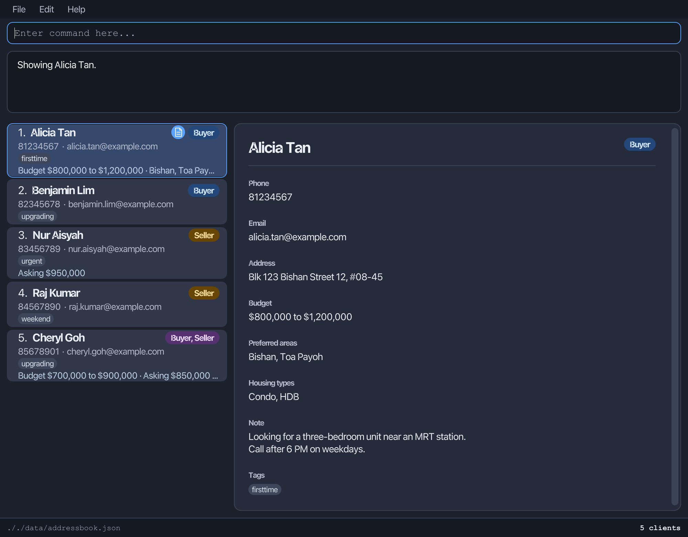
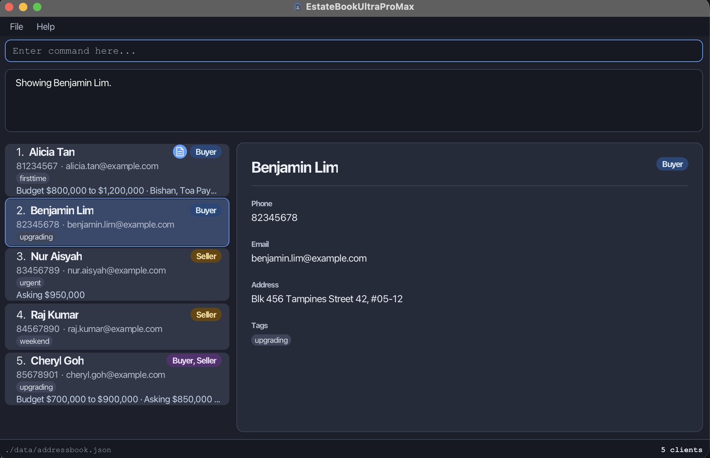

EstateBookUltraProMax is a **desktop client book for property agents who manage many buyers and sellers at once, optimized for use through a Command Line Interface (CLI)** while retaining the benefits of a Graphical User Interface (GUI). If you type quickly, EstateBookUltraProMax can help you manage your clients faster than traditional GUI applications. Each client record stores contact details, and can also record whether the client is a buyer, a seller or both, along with any requirements such as budget, preferred areas or housing type.

* Table of Contents
{:toc}

--------------------------------------------------------------------------------------------------------------------

## Quick start

1. Ensure that Java `25` or later is installed on your computer. 
   **Mac users:** Ensure you have the precise JDK version prescribed [here](https://se-education.org/guides/tutorials/javaInstallationMac.html).

1. Download the latest `.jar` file from [here](https://github.com/AY2627S1-CS2103T-W09-3/tp/releases).

1. Copy the file to the folder you want to use as the _home folder_ for EstateBookUltraProMax.

1. Open a terminal, `cd` to the folder containing the JAR file, and run `java -jar estatebookultrapromax.jar`. 
   A GUI similar to the one below should appear in a few seconds. 
   If no saved data file exists, the app starts with five sample clients:
   two buyers, two sellers, and one who is both.
   Otherwise, it loads your saved clients. 
   

1. Type a command in the command box and press Enter to execute it. For example, type **`help`** and press Enter to open the help window. 
   Some example commands you can try:

   * `list` : Lists all clients.

   * `add n/John Doe p/98765432 e/johnd@example.com a/John street, block 123, #01-01` : Adds a client named `John Doe` to EstateBookUltraProMax.

   * `delete 3` : Deletes the 3rd client shown in the current list.

   * `clear` : Shows a warning and deletes nothing. Enter `clear confirm` next to delete all clients.

   * `exit` : Exits the app.

1. Refer to the [Features](#features) section below for details of each command.

**:information_source: Keep each release in its own folder:** 

Keep each release's JAR file in its own writable folder and always run it from
that folder. The app creates its `data/` directory and `preferences.json` file
next to the JAR, so using a separate folder for each release keeps different
versions from sharing data or settings.

--------------------------------------------------------------------------------------------------------------------

## Features

**:information_source: Notes about the command format:** 

* Words in `UPPER_CASE` are the parameters to be supplied by the user. 
  For example, in `add n/NAME`, replace `NAME` with a value such as `John Doe`.

* Items in square brackets are optional. 
  For example, `n/NAME [t/TAG]` can be used as `n/John Doe t/friend` or as `n/John Doe`.

* Items followed by `…`​ can appear zero or more times. 
  For example, `[t/TAG]…​` may be omitted, or written as `t/friend` or `t/friend t/family`.

* Prefixed fields in `add` and `edit` can appear in any order. 
  For example, if the command specifies `n/NAME p/PHONE_NUMBER`, `p/PHONE_NUMBER n/NAME` is also acceptable.

* Commands that take no parameters reject anything after the command word with `Invalid command format. Use: <command>.`
  This applies to `help`, `list` and `exit`, and to `undo`, `redo` and `history`, so `help 123` and `exit now` are errors
  rather than being silently accepted.

* If you are using a PDF version of this document, be careful when copying and pasting commands that span multiple lines as space characters surrounding line-breaks may be omitted when copied over to the application.

### Input rules

These rules apply when adding or editing clients.

| Field | Rules |
|---|---|
| Name | Letters, numbers and spaces only; cannot be blank. Hyphens and apostrophes are not accepted. |
| Phone | At least 3 digits; no spaces, letters or symbols. |
| Email | Use `local-part@domain`. See the email rules below. |
| Address | Cannot be blank. |
| Budget | Two whole-dollar amounts joined by a hyphen, such as `400000-600000`. Each amount is from 1 to 1,000,000,000, commas are optional, and the first amount cannot exceed the second. |
| Asking price | One whole-dollar amount from 1 to 1,000,000,000, with optional correctly placed commas. |
| Area | One of the 32 supported areas. Case is ignored and the standard spelling is stored. |
| Housing type | `HDB`, `Condo`, `EC` or `Landed`, ignoring case. |
| Tag | Letters and numbers only; no spaces or symbols. |

Email rules:

* Before `@`, use letters, digits and the symbols `+`, `_`, `.`, `-`.
* These symbols cannot appear at the start or end, or consecutively.
* Domain labels use letters, digits and internal hyphens, separated by dots. The final label must have at least 2 characters.

Prefix rules:

* Each of `n/`, `p/`, `e/` and `a/` can appear only once per command.
* Repeat `t/` to supply multiple tags, such as `t/urgent t/firsttime`.
* For `edit`, use an empty `t/` to remove all tags.
* Each of `b/` and `s/` can appear only once per command.
* Repeat `l/` to supply multiple areas, such as `l/Bedok l/Tampines`.
* Repeat `h/` to supply multiple housing types, such as `h/HDB h/Condo`.
* For `edit`, an empty `b/`, `s/`, `l/` or `h/` clears that field. In `add`, an empty prefix is an error.

### Duplicate clients

An `add` or `edit` command is rejected if it would match another client's:

* Name, ignoring case.
* Phone number exactly.
* Email address, ignoring case. For example, `alpha.tester@EXAMPLE.COM` matches `alpha.tester@example.com`.

The existing records remain unchanged when the command is rejected.

For different clients with the same name, add a distinguishing word, such as
`Tan Wei Ming Bedok` and `Tan Wei Ming Tampines`. Their phone numbers and email
addresses must also be different.

For couples or co-buyers sharing contact details, keep one household record
and add the tag `t/couple`. Adding this tag does not allow duplicate records.

### Viewing help: `help`

Shows a message explaining how to access the help page.

Format: `help`

### Adding a client: `add`

Adds a client to the EstateBookUltraProMax.

Format: `add n/NAME p/PHONE_NUMBER e/EMAIL a/ADDRESS [b/MIN-MAX] [s/PRICE] [l/AREA]…​ [h/TYPE]…​ [t/TAG]…​`

:bulb: **Tip:**
A client can have any number of tags, including zero.

Examples:
* `add n/John Doe p/98765432 e/johnd@example.com a/John street, block 123, #01-01`
* `add n/Betsy Crowe t/friend e/betsycrowe@example.com a/Newgate Prison p/1234567 t/criminal`
* `add n/John Tan p/91234567 e/johntan@example.com a/12 Bedok Road b/400000-600000 l/Bedok h/HDB`

### Listing all clients: `list`

Shows all clients and clears the current search filter.

After using `find`, enter `list` to restore the complete client list.
For `view`, `edit`, `delete`, `role` and `note`, always use the index currently shown beside
the client. Indexes can change when the displayed list changes.

Format: `list`

### Viewing a client's details: `view`

Shows a client's full profile in the panel on the right and highlights their
card in the list. You can also click a client card to open the same profile.
Viewing a client does not change their data or the current search/filter.

Format: `view INDEX`

* `INDEX` is the positive integer shown beside a client in the **currently displayed list**.
  After `find` or `filter`, use the new displayed index, not the client's previous index.
* The panel shows the client's name, contact details and any recorded role,
  budget, asking price, preferred areas, housing types, note and tags.
  Optional fields with no value are hidden.
* Long text wraps. Notes preserve line breaks, and the panel scrolls vertically
  when the profile is taller than the available space. Selecting a client resets
  the panel to the top.
* With no selection, the panel shows `Select a client to see details.`

Examples using the initial sample clients:

* `list`, then `view 1`, shows Alicia Tan and the message `Showing Alicia Tan.`
* `find Cheryl`, then `view 1`, shows Cheryl Goh, the first client in those results.

*The panel after `list` followed by `view 1`. The document icon beside Alicia's name
marks that she has a note; scroll down within the panel to read the note and tags.*

*The panel after `find Cheryl` followed by `view 1`. Cheryl has no note, so her card
shows no note indicator.*

**When does the panel change?**

| Action | Panel behaviour                                                                                    |
|---|----------------------------------------------------------------------------------------------------|
| `view INDEX` or clicking a client card | Shows that client.                                                                                 |
| Successful `edit`, `role` or `note` | Shows the updated client if they still match the active search/filter; otherwise clears the panel. |
| Successful `find`, `filter`, `list`, `add`, `delete` or confirmed `clear` | Clears the panel. Select a client again using their current index.                                 |
| Successful `undo` or `redo` | Clears the panel. Select a client again using their current index. |
| `undo` or `redo` with no available action | Keeps the current selection. |
| `help`, `history`, the initial non-empty-book `clear` warning, or invalid command input | Keeps the current selection when the displayed list has not changed.                               |
| Cancelling a pending clear | Clears the panel without deleting any clients; the cancelling input is not executed.               |

Clearing the panel prevents it from showing an outdated client when a list
change moves a different client into the same index. It does not delete data.
Even if `list` or `find` produces the same results, a successful command clears
the selection so that you can choose from the current list again.

**Invalid input:** `view`, `view abc` and `view 1 extra` show
`Error: Invalid command format. Use: view INDEX.` An index of zero, a negative index,
or an index outside the displayed list shows `Error: The client index provided is invalid.`
Outside a pending `clear` confirmation, a rejected `view` shows the error above and leaves
the existing profile unchanged. If a `clear` confirmation is pending, any `view` input,
valid or not, cancels the clear instead: you see `Clear cancelled.`, `view` is not run,
and the panel is cleared. Enter `view INDEX` again to open the profile.

### Editing a client: `edit`

Edits an existing client in EstateBookUltraProMax.

Format: `edit INDEX [n/NAME] [p/PHONE] [e/EMAIL] [a/ADDRESS] [b/MIN-MAX] [s/PRICE] [l/AREA]…​ [h/TYPE]…​ [t/TAG]…​`

* Edits the client at the specified `INDEX`. The index refers to the index number shown in the displayed client list. The index **must be a positive integer** 1, 2, 3, …​
* At least one of the optional fields must be provided.
* Existing values will be updated to the input values.
* When editing tags, all of the client's existing tags are removed; adding tags is not cumulative.
* To remove all of a client's tags, enter `t/` without a tag after it.
* An `edit` replaces a whole value: `edit 1 l/Punggol` leaves `Punggol` as the only area, so list every area again to keep it.
* An empty `b/`, `s/`, `l/` or `h/` clears that field: `edit 1 b/` removes the budget and `edit 1 l/` removes every area.
* After a successful edit, the current search or filter stays active. The edited client leaves the list if it no longer matches. Enter `list` to show all clients.

Examples:
*  `edit 1 p/91234567 e/johndoe@example.com` Edits the phone number and email address of the 1st client to be `91234567` and `johndoe@example.com` respectively.
*  `edit 2 n/Betsy Crower t/` Edits the name of the 2nd client to be `Betsy Crower` and clears all existing tags.

### Recording a client's requirements: `b/`, `s/`, `l/`, `h/`

A client's requirements are optional and can be supplied with `add` or changed
with `edit`. `b/` is the budget, `s/` the asking price, `l/` a preferred area and
`h/` a preferred housing type.

Money is in whole Singapore dollars: no cents, no decimal point, and no `$` typed
into the command. Each amount must be from 1 to 1,000,000,000. Commas are optional
as long as they are correctly placed, so `400000`, `400,000` and `1,000,000` are
accepted and `4000,00` is rejected. The app displays each amount with a dollar
sign and thousands separators, such as `$520,000`.

A budget is two amounts joined by a hyphen, smallest first: `b/400000-600000`.
The two amounts may be equal, which displays as a single amount. `b/600000-400000`
is rejected because the minimum exceeds the maximum.

Area names are matched ignoring case and stored in title case, so `l/bedok` stores
`Bedok`. Repeat `l/` for more than one area, as in `l/Bedok l/Tampines`. These are
the 32 supported areas:

| Area | | | |
|---|---|---|---|
| Ang Mo Kio | Bedok | Bishan | Bukit Batok |
| Bukit Merah | Bukit Panjang | Bukit Timah | Choa Chu Kang |
| Clementi | Downtown Core | Geylang | Hougang |
| Jurong East | Jurong West | Kallang | Marine Parade |
| Newton | Novena | Orchard | Pasir Ris |
| Punggol | Queenstown | River Valley | Rochor |
| Sembawang | Sengkang | Serangoon | Tampines |
| Tanglin | Toa Payoh | Woodlands | Yishun |

Housing types are `HDB`, `Condo`, `EC` and `Landed`, matched ignoring case.
Repeat `h/` for more than one, as in `h/HDB h/Condo`.

Examples:

* `add n/John Tan p/91234567 e/johntan@example.com a/12 Bedok Road b/400000-600000 s/520000 l/Bedok l/Tampines h/HDB`
  adds a client who can spend up to $600,000, is asking $520,000 for their own flat,
  and wants an HDB flat in Bedok or Tampines.
* `edit 1 b/500000-700000` replaces the first client's budget with $500,000 to $700,000.
* `edit 1 s/` removes the first client's asking price.
* `edit 2 h/Condo` replaces all of the second client's housing types with `Condo`.
* `edit 3 l/` removes all of the third client's preferred areas.

Inputs that are rejected:

| Command contains | Result box shows |
|---|---|
| `b/600000-400000` | `Error: The budget minimum must not exceed the maximum.` |
| `b/400000` | `Error: Prices must be whole numbers from 1 to 1,000,000,000, with optional correctly placed commas.` |
| `s/0` | `Error: Prices must be whole numbers from 1 to 1,000,000,000, with optional correctly placed commas.` |
| `l/Bishan East` | `Error: Area must be one of the supported areas.` |
| `h/Shophouse` | `Error: Housing type must be HDB, Condo, EC, or Landed.` |
| `b/1-2 b/3-4` | `Error: Multiple values specified for the following single-valued field(s): b/` |

### Assigning or clearing a client's role: `role`

Marks a client as a buyer, a seller, or both, or removes an assigned role.

Format: `role INDEX ROLE`

* `INDEX` must be a positive integer referring to a client in the displayed list.
* `ROLE` accepts `buyer`, `seller`, `both`, or `none`, ignoring case. Use `none` to remove an assigned role.
* The client card displays `Buyer`, `Seller`, or `Buyer, Seller` for assigned roles. It shows no role badge after `none`.
* Newly added clients have no role assigned.
* Assigning a role replaces any existing role. Clearing a role leaves the client's other details unchanged.
* If the client already has no role, `none` reports that nothing changed and does not add an undo-history entry.
* After a successful role change, the current search or filter stays active. The client leaves the list if the new role no longer matches it. Enter `list` to show all clients.

Examples:

* `role 1 buyer` marks the first displayed client as a buyer.
* `role 2 both` marks the second displayed client as both a buyer and a seller.
  The role badge displays `Buyer, Seller`.
* `role 1 none` removes the first displayed client's assigned role.

For example, if the first displayed client is John Doe, `role 1 buyer` displays:
`Role updated: John Doe is now marked as Buyer`

For a client named John Doe, `role 1 none` displays:
`Role cleared: John Doe has no assigned role`

Repeating the command displays:
`Role unchanged: John Doe already has no assigned role`

### Adding or clearing a client note: `note`

Sets or clears the note belonging to a displayed client.

Formats:

* `note INDEX TEXT` to add or replace a note.
* `note INDEX clear` to clear a note.

* `INDEX` must be a positive integer referring to a client in the displayed list.
* `TEXT` can contain spaces and must contain between 1 and 500 characters after `\n` is decoded and surrounding whitespace is removed.
* Type the two characters `\n` where a line break should appear in the note.
* Only the exact lowercase text `clear`, after surrounding whitespace is removed, clears the note.
* Other capitalization and text containing `clear` are stored as ordinary note text.
* The currently displayed client filter remains active after setting or clearing a note.
* Read the note in the [detail panel](#viewing-a-clients-details-view). The note row is hidden when the note is cleared.

Examples:

* `note 1 Call again next Monday` adds or replaces the first displayed client's note.
* `note 2 First line\nSecond line` stores a note containing two lines.
* `note 3 clear` clears the third displayed client's note.
* `note 1 Clear` stores `Clear` as ordinary note text.
* `note 1 CLEAR` stores `CLEAR` as ordinary note text.
* `note 1 Call to clear documents` stores the full sentence as ordinary note text.

### Finding clients: `find`

Finds clients whose name, phone number, email address, or address contains a keyword.

Format: `find KEYWORD [MORE_KEYWORDS]`

* A keyword matches any part of a name, phone number, email address, or address, ignoring case. The part can be at the start, in the middle, or at the end.
  For example, `ali` matches `Alicia Tan`, `8456` matches `84567890`, `raj.k` matches `raj.kumar@example.com`, and `bishan` matches `Blk 123 Bishan Street 12, #08-45`.
* Multiple keywords use AND matching: a client appears only if **every** keyword matches their name, phone number, email address, or address.
  Different keywords can match different fields, so `Alicia 8123` matches a client named Alicia whose phone number contains `8123`.
  Each extra keyword narrows the results, so add the rest of a client's name to find one client.
* Keyword order does not matter.
* Short keywords match many clients. For example, `a` appears in every sample client's email address, so it shows all of them.
  Common address words such as `Blk` and `Street` also match many clients.
  Check the count in the result line, and add another keyword or type more of the name, phone number, email address, or address to narrow the list.
* Entering `find` without keywords shows an error and leaves the displayed list unchanged.
* Notes are not searched. A note is free-text working detail in which any word may appear, so matching it would return clients for the wrong reason.
* Use `list` to show all clients again.
* The result line shows how many clients are displayed out of all clients, e.g. `Showing 2 of 5 clients.`.
  It says `clients` even when the number is 1, e.g. `Showing 1 of 5 clients.`.
* While a search or filter is active, the status bar keeps showing the displayed and total counts, even after another
  command replaces the result line. It also reminds you to use `list` to show all clients again.
* If no clients match, the result shows 0 clients out of the total, for example `Showing 0 of 5 clients.`.

Examples using the sample clients:

* `find ali` finds Alicia Tan by part of her name.
* `find 8456` finds Raj Kumar by part of his phone number, `84567890`.
* `find raj.k` finds Raj Kumar by part of his email address, `raj.kumar@example.com`.
* `find Bishan` finds Alicia Tan, whose address is `Blk 123 Bishan Street 12, #08-45`.
* `find Tampines Benjamin` finds Benjamin Lim, because `Tampines` matches his address and `Benjamin` matches his name.
* `find Street` finds Alicia Tan, Benjamin Lim, Nur Aisyah and Raj Kumar, because all four addresses contain `Street`.
  The result shows `Showing 4 of 5 clients.`.
* `find ali tan` finds Alicia Tan, because both keywords match her name.
* `find tan 8123` finds Alicia Tan, because `tan` matches her name and `8123` matches her phone number, `81234567`.
* `find Alicia 82345678` shows no clients (`Showing 0 of 5 clients.`), because `82345678` is Benjamin Lim's phone number and not Alicia Tan's.
* `find 5678` finds Benjamin Lim, Nur Aisyah, Raj Kumar and Cheryl Goh, because all four phone numbers contain `5678`.
  The result shows `Showing 4 of 5 clients.`.

### Filtering clients by role, tag and requirements: `filter`

Shows only the clients who match a role, a tag, or any of their recorded requirements: preferred area, preferred housing type, budget and asking price.

Format: `filter [r/ROLE] [t/TAG]…​ [l/AREA]…​ [h/TYPE]…​ [b/BUDGET] [s/PRICE]`

* `ROLE` accepts `buyer`, `seller`, or `both`, ignoring case. Only one `r/` may be given.
* `r/buyer` shows buyers and clients marked `both`. `r/seller` shows sellers and clients marked `both`. `r/both` shows only clients marked `both`.
* A client with no role never matches a role.
* A tag matches a client's tag with the same name, ignoring case. The whole tag must match, so `t/urgent` does not match `urgently`.
* Repeat `t/` to give several tags. A client matches if they have **any** of them (OR).
* `AREA` is one of the [supported areas](#recording-a-clients-requirements-b-s-l-h), ignoring case. Repeat `l/` to give several areas. A client matches if **any** of their preferred areas is one of them (OR).
* `TYPE` is `HDB`, `Condo`, `EC` or `Landed`, ignoring case. Repeat `h/` to give several housing types. A client matches if **any** of their preferred housing types is one of them (OR).
* `BUDGET` is a price range written `MIN-MAX`, such as `b/500000-600000`, or a single price, such as `b/850000`. A client matches if their budget has at least one price in common with it, counting both ends. So `b/850000` shows every client whose budget includes $850,000, and `b/900000-1000000` shows every client whose budget overlaps that range. Only one `b/` may be given.
* `PRICE` is also a range written `MIN-MAX`, or a single price. A client matches if their asking price is within the range, counting both ends, so `s/850000` shows only clients asking exactly $850,000. Only one `s/` may be given.
* Prices follow the same rules as in `add` and `edit`: whole dollars from 1 to 1,000,000,000, with optional correctly placed commas. A range must be two prices joined by a hyphen, such as `500000-600000`, and one with a minimum above its maximum is rejected.
* A client with no preferred area, no preferred housing type, no budget or no asking price never matches a filter on that field.
* When several kinds of criteria are given, a client must match **all** of them (AND), but only one of the values within `t/`, `l/` or `h/` (OR). For example, `filter r/buyer l/Bedok h/HDB` shows buyers who want Bedok **and** an HDB flat.
* All parts are optional. `filter` with nothing after it shows every client.
* Text before the first prefix, such as `filter buyer`, is an error. An invalid role, tag, area, housing type or price also shows an error and leaves the displayed list as it was.
* The result line shows how many clients are displayed out of all clients in the book, e.g. `Showing 8 of 34 clients.`. The word `clients` is used even when the number is 1.

**How the filter behaves afterwards:**

* `filter` replaces any filter or `find` search that is already active. It does not combine with it.
* `find` also replaces an active filter. Use `list` to clear the filter and show all clients.
* The filter stays active after `add`, `edit`, `delete`, `role`, `note` and `clear confirm`, so the displayed list can still be shorter than the whole book. Indexes in these commands refer to the displayed list.
* After `add`, `edit` or `role`, the changed client is checked against the active filter again. A client who no longer matches leaves the displayed list. For example, after `filter r/buyer`, `role 1 seller` removes client 1 from the list. In the same way, after `filter t/urgent`, `edit 1 t/weekend` removes client 1, because the client no longer has the `urgent` tag, and after `filter l/Bishan`, `edit 1 l/Orchard` removes client 1, because the client no longer wants Bishan.
* Only `add` can make a client appear, and only if the new client matches. For example, after `filter t/urgent`, adding a client tagged `urgent` shows them, and after `filter l/Bishan`, adding a client with `l/Bishan` shows them. A new client has no role, so after `filter r/buyer` they stay hidden; run `list` and give them a role, then filter again.
* `delete` removes the client from the list, and `note` never changes which clients are shown, because a filter does not look at notes.
* `clear confirm` deletes every client, including the hidden ones, but the filter stays active. A client added afterwards stays hidden unless they match it, so run `list` to show everyone.

Examples:

* `filter r/buyer` shows all buyers, including clients marked `both`.
* `filter t/urgent t/firsttime` shows clients tagged `urgent` or `firsttime`.
* `filter r/buyer t/urgent` shows buyers (including `both`) who are tagged `urgent`. On the sample clients this shows no clients (`Showing 0 of 5 clients.`), because the only `urgent` client, Nur Aisyah, is a seller.
* `filter r/both` shows only clients who are both a buyer and a seller.
* `filter l/Bishan l/Tampines` shows clients who want Bishan or Tampines. On the sample clients these are Alicia Tan and Cheryl Goh.
* `filter h/HDB` shows clients who want an HDB flat. On the sample clients these are Alicia Tan and Cheryl Goh.
* `filter l/Tampines h/EC` shows clients who want both Tampines and an executive condominium. On the sample clients this is only Cheryl Goh.
* `filter b/850000` shows clients whose budget includes $850,000. On the sample clients these are Alicia Tan ($800,000 to $1,200,000) and Cheryl Goh ($700,000 to $900,000).
* `filter b/1000000-1500000` shows clients whose budget overlaps $1,000,000 to $1,500,000. On the sample clients this is only Alicia Tan.
* `filter r/seller s/900000-1000000` shows sellers asking between $900,000 and $1,000,000. On the sample clients this is only Nur Aisyah, who is asking $950,000.

### Deleting a client: `delete`

Deletes the specified client from EstateBookUltraProMax.

Format: `delete INDEX`

* Deletes the client at the specified `INDEX`.
* The index refers to the index number shown in the displayed client list.
* The index **must be a positive integer** 1, 2, 3, …​

Examples:
* `list` followed by `delete 2` deletes the 2nd client in EstateBookUltraProMax.
* `find Betsy` followed by `delete 1` deletes the 1st client in the results of the `find` command.

### Clearing all entries: `clear`

Deletes every client from EstateBookUltraProMax after you confirm.

Format: `clear`, then `clear confirm`

1. Enter `clear`. Nothing is deleted yet. The result box shows a warning, the command box is outlined in amber and its prompt asks you to confirm, to show that a confirmation is pending.
   * For one client: `This will delete the only client. Type clear confirm to proceed.`
   * For two or more clients: `This will delete all N clients. Type clear confirm to proceed.`
2. Enter `clear confirm` to delete all clients. The result box shows `Client book has been cleared!`
3. Enter any other non-empty input to cancel. The result box shows `Clear cancelled.` and nothing is deleted.

* `N` is the total number of clients, including clients hidden by a search filter.
* `confirm` ignores case, so `clear CONFIRM` and `clear Confirm` also delete all clients. The command word `clear` must still be lowercase, as with every command.
* Anything else after `clear`, such as `clear confrim`, is not a confirmation. It cancels a pending clear and shows `Clear cancelled.`.
* The input that cancels is not run as a command. For example, entering `exit` while a confirmation is
  pending cancels it but does not exit, so enter `exit` again.
* Pressing Enter on a completely empty command box does nothing and the confirmation stays pending.
  A single space counts as input and cancels.
* If there are no clients, `clear` shows `The client book is already empty.` and no confirmation is pending.
* `clear confirm` only works straight after `clear`, regardless of how `confirm` is capitalised. Otherwise it shows `No clear is pending. Type clear first.`
* When no clear is pending, any other word after `clear` shows `Invalid command format. Use: clear.`
* A pending confirmation is not saved, so closing the app cancels it.

:exclamation: **Warning:**
`clear confirm` deletes every client. You can undo it only while it remains in the current session's
history. Keep a separate backup of important data.

### Undoing, redoing and viewing changes: `undo`, `redo`, `history`

Use `undo` to reverse the most recent change to client data, and `redo` to reapply the most recently
undone change. Use `history` to see the available undo and redo actions in separate lists, newest first.

Formats: `undo`, `redo`, `history` (no parameters)

* Changes made by `add`, `edit`, `delete`, `role`, `note` and `clear confirm` can be undone. A confirmed
  clear is one action, so one `undo` restores all clients it removed.
* Read-only commands, failed commands, a cancelled or unconfirmed `clear`, and commands that leave the
  client data unchanged do not add history entries.
* Up to 20 recent changes are kept. When the limit is reached, the oldest undoable change is discarded.
* After an `undo`, making a new change clears the redo list. For example, after `add`, `undo`, then `edit`,
  the undone `add` can no longer be redone.
* If there is nothing to undo or redo, the command reports that no action is available. If both lists are
  empty, `history` reports that there is no history.
* `history` does not change the client list or close an open client profile, even when both history lists are empty.
* History is kept only for the current app session. Closing and reopening the app keeps the saved client
  data but starts with empty undo and redo lists.
* You can also use **Edit > Undo**, **Edit > Redo** and **Edit > History**. Undo shortcuts are `Ctrl+Z`
  and `Cmd+Z`; redo shortcuts are `Ctrl+Y` and `Cmd+Shift+Z`. They work while the command box has focus.
  The Undo and Redo menu items are disabled when there is no corresponding action available.
* If `clear` is awaiting confirmation, an Edit menu action or undo/redo shortcut cancels that
  confirmation instead of performing the action. The result box shows `Clear cancelled.`; use the
  action again after cancellation.
* With focus in the command box, undo/redo shortcuts run the app's commands rather than the text
  field's undo/redo. Any unfinished command text stays in the box. If there is nothing to undo or
  redo, the result box reports the error without marking that unfinished text as invalid.

For example, enter `delete 2`, then `undo` to restore that client. Enter `redo` to delete the client again.

### Exiting the program: `exit`

Exits the program.

Format: `exit`

### Saving the data

EstateBookUltraProMax automatically saves data after successful commands.
You do not need to save manually.

Data is stored in `data/addressbook.json`, relative to the folder from which
you launch the application (the working directory).

If you follow Quick Start and launch from the folder containing the JAR,
the `data` folder will be created there. Always launch from the same folder
to load the same client records.

### Backing up and restoring data

**To back up your data:**

1. Close the application.
2. Copy `data/addressbook.json` to a safe location outside the `data` folder.

**To restore a backup:**

1. Close the application.
2. Keep a separate copy of your current `data/addressbook.json`.
3. Replace `data/addressbook.json` with your backup.
4. Restart the application from the same working directory.

### Recovering from an invalid data file

If the data file cannot be loaded, the application first saves a copy beside
it named `addressbook.json.unreadable-<unique number>.bak`. Once that backup
succeeds, the application starts with an empty client list and shows a warning
before any command can replace the original file. If the backup cannot be
created (for example, because the data folder is not writable), startup stops
instead; the original data file is left unchanged. Make the folder writable or
free up disk space, then restart the application.

You can continue using the empty client book, but a successful command can
replace `data/addressbook.json`. The `.bak` copy remains unchanged. Keep it
until you have recovered your clients.

To recover, close the application, copy the `.bak` file to a safe location,
then repair its JSON or restore a known valid backup using the steps above.
Copying an unreadable file back without repairing it will not restore the
clients. JSON files saved with a UTF-8 or UTF-16 byte-order mark can be loaded
without repair.

Before manually editing the JSON file, close the application and make
a backup. Invalid formatting, invalid field values or duplicate clients
can prevent the file from loading.

--------------------------------------------------------------------------------------------------------------------

## FAQ

**Q**: How do I transfer my data to another computer? 
**A**: Follow Quick Start to set up the app on the new computer, then close
the app on both computers. Back up any existing data on the new computer.
Copy `data/addressbook.json` from the old computer into the `data` folder
of the new computer's working directory, creating the folder if needed.
Restart the app from that working directory.

--------------------------------------------------------------------------------------------------------------------

## Known issues

1. **When using multiple screens**, if you move the application to a secondary screen, and later switch to using only the primary screen, the GUI will open off-screen. The remedy is to delete the `preferences.json` file created by the application before running the application again.
2. **If you minimize the Help Window** and then run the `help` command (or use the `Help` menu, or the keyboard shortcut `F1`) again, the original Help Window will remain minimized, and no new Help Window will appear. The remedy is to manually restore the minimized Help Window.

--------------------------------------------------------------------------------------------------------------------

## Command summary

Action | Format, Examples
--------|------------------
**Add** | `add n/NAME p/PHONE_NUMBER e/EMAIL a/ADDRESS [b/MIN-MAX] [s/PRICE] [l/AREA]…​ [h/TYPE]…​ [t/TAG]…​`   e.g., `add n/James Ho p/22224444 e/jamesho@example.com a/123, Clementi Rd b/400000-600000 l/Clementi h/HDB`
**Clear** | `clear`, then `clear confirm`  `clear` shows a warning and `clear confirm` deletes all clients
**Delete** | `delete INDEX`  e.g., `delete 3`
**Edit** | `edit INDEX [n/NAME] [p/PHONE] [e/EMAIL] [a/ADDRESS] [b/MIN-MAX] [s/PRICE] [l/AREA]…​ [h/TYPE]…​ [t/TAG]…​`  e.g., `edit 2 b/500000-700000 l/Bedok`
**Filter** | `filter [r/ROLE] [t/TAG]…​ [l/AREA]…​ [h/TYPE]…​ [b/BUDGET] [s/PRICE]`  e.g., `filter r/buyer t/urgent`, `filter l/Tampines h/EC`, `filter b/850000`
**Find** | `find KEYWORD [MORE_KEYWORDS]`  e.g., `find ali`, `find 8456`, `find raj.k`, `find Bishan`
**Note** | `note INDEX TEXT`  e.g., `note 1 Call next week`, `note 1 clear`
**Role** | `role INDEX ROLE`  e.g., `role 1 buyer`
**View** | `view INDEX`  e.g., `view 1`
**Undo** | `undo`  Reverses the most recent change
**Redo** | `redo`  Reapplies the most recently undone change
**History** | `history`  Lists available undo and redo actions
**List** | `list`
**Help** | `help`
**Exit** | `exit`
